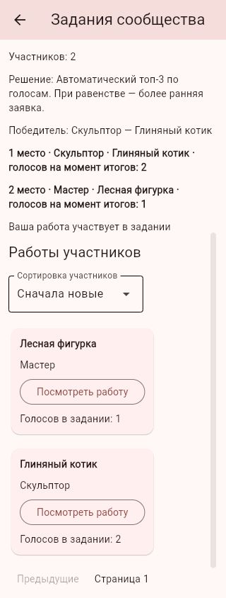
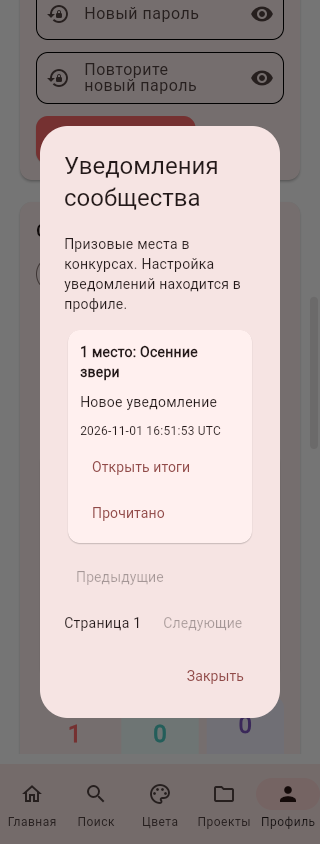
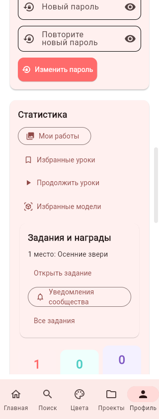
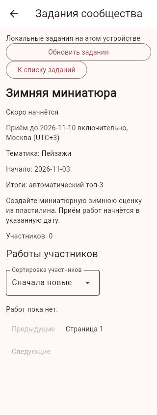

# Период конкурса, автоматические итоги и призовые уведомления

01.11.2026, Москва. Продолжение блока №18, ветка `feature/challenge-results-notifications`.

## Поведение

В форме администратора появились тематика, дата начала и режим итогов. Пустая дата начала означает сегодня. Начало и конец включаются в период по Москве (UTC+3), начало не может быть раньше сегодняшнего дня или позже конца; максимальный конец — год вперёд. До начала показывается «Скоро начнётся», заявки и голосование недоступны.

В новой форме по умолчанию выбрано **«Автоматически: топ-3 по голосам»**. Старые конкурсы и API-запросы без поля `resultMode` сохраняют ручной режим; миграция не переписывает их решения. Ручной режим также можно выбрать в форме.

Автоматические итоги после окончания дня:

- выбираются до трёх доступных работ подтверждённых незаблокированных пользователей;
- учитываются отдельные конкурсные голоса доступных подтверждённых незаблокированных аккаунтов;
- при равенстве голосов выше более ранняя заявка, затем меньший ID публикации;
- работы с нулём голосов тоже могут получить место; если участников меньше трёх, мест соответственно меньше;
- задание, призовые места, число голосов и уведомления сохраняются одной транзакцией, итог фиксируется один раз;
- администратор не может заменить результат автоматического конкурса ручным выбором; до окончания срока можно отменить конкурс; по истечении срока отмена недоступна, даже если фоновая задача ещё не успела зафиксировать места;
- в журнале появляется «Автоматические итоги конкурса» от «Система»;
- удаление публикации или аккаунта после итогов не пересчитывает места остальных: карточка показывает недоступного участника/удалённую работу, число голосов на момент итогов остаётся;
- отменённые конкурсы не получают автоматические награды; пустой конкурс завершается без победителей.

В серверном процессе проверка работает при запуске и затем каждые 30 секунд. При остановке сервера задача корректно завершается; при ошибке SQLite будет повтор. Пока сервер выключен, задача не выполняется: просроченные конкурсы обрабатываются после запуска. Также расчёт выполняется при чтении списка, деталей, профиля участия и уведомлений. В локальном приложении расчёт выполняется при этих открытиях; фонового процесса при закрытом приложении нет.

## Профиль и уведомления

В профиле появился блок **«Задания и награды»**: до пяти недавних участий из последних двадцати, призовое место/статус и переход непосредственно к заданию. Полный список остаётся в разделе заданий, фильтр «Мои заявки».

Кнопка **«Уведомления сообщества»** открывает личный список призовых мест, страницы по 50, отметку «Прочитано» и переход к итогам. Прочитать чужое уведомление нельзя. Повторная обработка конкурса не создаёт дубликатов. Призовое уведомление создаётся, только если в момент определения результата включена настройка уведомлений профиля; старые сообщения после выключения сохраняются. Ручной победитель в новых итогах также получает призовое уведомление.

Это уведомления **внутри приложения о призовых местах**, а не push, email, сообщения о лайках/комментариях или общий завершённый центр уведомлений. Реальной отправки почты нет.

## API и данные

`POST /admin/challenges` дополнительно принимает `startsOn` (дата/`null`), `theme` (до 80 символов), `resultMode` (`manual`/`votes`, без поля — `manual`).

`GET /community/challenges/{id}` возвращает `awards` с местом, публикацией, доступными названием/автором и зафиксированными голосами.

Личные маршруты с действующей Bearer-сессией:

- `GET /community/challenge-profile`;
- `GET /community/notices?offset=0`;
- `PUT /community/notices/{noticeId}/read`.

Шлюз поддерживает локальное хранение и сервер, сохраняет проверки сессии, текущего API и принадлежности серверных ID. Добавлены колонки `startsOn`, `theme`, `resultMode` и таблицы `challengeAwards`, `communityNotices`. Инициализация сохраняет существующие записи. Удаление аккаунта удаляет его личные уведомления, исторические призовые места обезличиваются через внешние ключи; личные проекты не затрагиваются.

## Проверки и оставшаяся работа

Проверяются автоматический топ-3/равные и нулевые голоса, период, пустые/отменённые конкурсы, заблокированные участники/голосующие, настройки уведомлений, чужие сообщения, повторный и параллельный расчёт, откат при ошибке, удаление победителя и аккаунта. UI-тест проходит профиль, чтение уведомления и переход к нужному заданию.

Остаются автоматические теги при публикации и отбор по тегам/датам, сетка фотографий участников, другие социальные уведомления, общая проверка Android с контрольным APK и редизайн. Пункты 4.1.22 и 4.1.23 пока не считаются полностью выполненными. Исходное ТЗ не менялось.

Браузерная проверка двумя синтетическими аккаунтами на 320 px прошла: профиль с наградой, уведомление/прочтение, переход к итогам, призовые места, отложенный старт и форма администратора. Ошибок страницы нет.

Физический Android в этом пакете не проверен; новый APK не собирался.

Проверки: полный набор из 336 тестов прошёл; после уточнения защиты отмены просроченного автоматического конкурса повторно прошли 20 тестов конкурсной логики.
