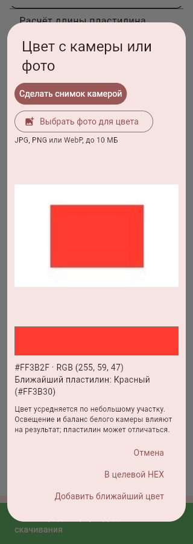
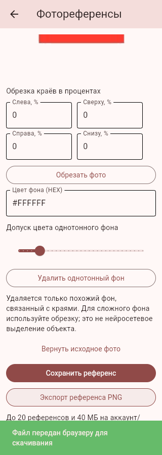

# Блок №28 — сохранение файлов, камера, PDF, сантиметры и референсы

02.11.2026. Исходное ТЗ и исторический Plan сохранены. Работа продолжается от блока №27.

## Исправление PNG нулевого размера

Прежняя Android-ветка вызывала FilePicker.save_file, затем передавала результат в Python Path.open('xb'). Android выдаёт content:// URI документа, а не путь обычной файловой системы. Документ уже мог быть создан выборщиком, но Python не записывал в него данные. Для обычной папки на ПК существующий пустой файл также мешал эксклюзивному 'xb'.

Android теперь получает байты до открытия ACTION_CREATE_DOCUMENT, пишет через ContentResolver, закрывает поток, читает результат обратно и проверяет размер/SHA-256. При неудаче выполняется попытка удалить созданный документ, сообщение об успехе появляется только после проверки. Отмена не считается ошибкой. Сохранение и камера асинхронны, без восьмисекундного ограничения защищённого хранилища и без блокировки его обычных команд. Чтение/проверка файла выполняются вне главного Android-потока.

На ПК запись идёт в соседний временный файл с flush/fsync и атомарной заменой. Пустой файл, созданный выборщиком, заполняется корректно. Для замены существующего непустого файла требуется подтверждение в интерфейсе; ошибка оставляет прежние данные. Веб использует прежний одноразовый механизм скачивания. Общий механизм применён к PNG/PDF рецепта и PNG фотореференса. Старый уже сохранённый файл 0 байт не содержит рецепта для восстановления: рецепт нужно экспортировать снова.

## Камера и выбор цвета

«Цвета» → «Сканировать цвет с камеры». Android запускает установленную камеру через системное действие с временным FileProvider URI. Широкие разрешения на память не нужны. Снимок уменьшается, учитывается ориентация EXIF, метаданные исходника не переносятся в результат, временный файл очищается. Если камера недоступна, есть выбор фото.

В веб-версии камера включается только кнопкой пользователя. getUserMedia требует HTTPS или localhost; на HTTP домашней сети используется input capture/выбор снимка. После загрузки пользователь возвращается в приложение и нажимает «Использовать снимок браузера». Фото нормализуется в JPEG. Камера ПК в отдельном Flet-окне не встроена — доступен выбор готового фото; веб-версия может использовать камеру браузера.

На фото пользователь касается нужного участка. Цвет усредняется по небольшой области, прозрачные пиксели и поля вокруг изображения не учитываются. Показаны RGB, HEX и ближайший базовый цвет по евклидову расстоянию RGB. Можно перенести HEX в целевой цвет или добавить ближайший цвет в смесь; тяжёлый подбор рецепта не запускается автоматически. Погрешности освещения/баланса белого и различия реального пластилина отображаются в интерфейсе. Камера не является калиброванным колориметром.

## PDF, сантиметры и поиск

PNG и PDF используют один актуальный рецепт. PDF — одна страница A4 с растровым изображением и встроенной в изображение кириллицей, без зависимости от шрифтов телефона. Текст PDF не выделяется как векторный. При включённом расчёте сантиметры также видны в экспорте.

Ввести массу и длину своего целого бруска. Формула: длина компонента = его масса / масса целого бруска × длина целого бруска. Сечение и плотность считаются одинаковыми для всех цветов выбранного набора; при другом наборе нужно изменить калибровку. Нулевые/бесконечные/отрицательные значения отклоняются. В смеси сохраняется исходный рецепт в граммах, параметры линейной калибровки не добавлены в прежний формат хранения смеси.

Добавлены поиск базовых цветов по названию/HEX и поиск своих смесей по названию/HEX. Подбор ближайшего RGB используется при сканировании; прежний целевой HEX и подбор смеси сохранены.

## Фотореференсы

«3D-галерея» → «Мои фотореференсы»: фото, обрезка краёв в процентах, удаление однотонного фона с регулируемым допуском, просмотр и возврат исходного изображения до сохранения, прозрачный PNG. Удаляется только похожий фон, связанный с краями: внутренние области того же цвета сохраняются. Для сложных сцен доступна ручная обрезка; нейросетевое выделение объекта и AR не добавлены.

До 20 изображений/40 МБ на аккаунт и адрес API. Обработка и хранение выполняются на устройстве; на веб — в процессе приложения на ПК. Выбор файла/снимка инициируется пользователем. Референсы и их удаление привязаны к владельцу, чужой аккаунт их не видит. Новые референсы, как и кеш/прогресс каталога №27, пока не включены в перенос личным снимком №24; это остаётся в финальной сверке. Временная исходная фотография редактора не сохраняется после закрытия; сохраняется обработанный PNG.

## Проверки

Проверяются запись PNG вместо пустого файла, отказ/атомарность/сохранность прежнего файла, передача настоящих байтов Android-операции без FilePicker.save_file, неблокирующий UI-мост, выбор участка с полями/прозрачностью, ближайший RGB, обрезка, связный фон, метаданные, PDF и линейная формула, квоты/владельцы/удаление аккаунта, Flet-диалог сканирования. Системная камера и запись через конкретного Android-провайдера требуют проверки на физическом устройстве.

После этого блока следующие две группы: №29 редизайн и доступность, №30 финальная Android-приёмка/исправления/релиз с учётом известных ограничений. Google OAuth, английский язык, FCM и полнота переноса не объявляются автоматически закрытыми.

## Итоги программной проверки

Полный прогон: **459 тестов прошли**. В настоящем браузере получены PNG-рецепт (непустой, читается Pillow) и PDF; pdfinfo подтверждает одну страницу A4, без JavaScript и шифрования. В браузерной странице камеры выбран тестовый снимок, передан как JPEG, выбран участок фото и применён HEX. На ширине 320 px видны RGB и ближайший красный цвет. Референс загружен, фон удалён, изображение сохранено и скачано: у PNG край имеет alpha=0, центр alpha=255. Ошибок JS нет. Использованы только синтетические изображения и отдельная база; физическая камера не включалась в ходе проверки.

## Поставка 0.12.0

[APK Android 9+, ARM64](https://github.com/Gr1zle/lepka_helper/raw/refs/heads/artifacts/android-demo-20261031/lepka-helper-0.12.0-tools-arm64.apk) · [Серверный ZIP](https://github.com/Gr1zle/lepka_helper/raw/refs/heads/artifacts/android-demo-20261031/lepka-server-0.12.0.zip) · [PR №28](https://github.com/Gr1zle/lepka_helper/pull/28).

[GitHub Actions: все 459 тестов прошли](https://github.com/Gr1zle/lepka_helper/actions/runs/41479042771). Итоговый локальный прогон повторён: 459/459. Source/runtime — `c974008`, артефакты — `968fa04` в ветке artifacts/android-demo-20261031. Программная проверка не подменяет тест настоящего Android ContentResolver/камеры.

APK versionCode 2009, версия 0.12.0, около 38 МБ. Подпись совпадает с 0.11.0. Проверены целостность, совпадение всех Python-модулей/экранов/ресурсов с текущим кодом и всех нативных исходников с wheel; файлов/камеры MediaActions, прежних Keystore/уведомлений/видео в DEX; закрытый FileProvider с правильным authority и grantUriPermissions. Личных баз/сессий/секретов внутри нет. Широкие разрешения на память и собственное разрешение CAMERA не добавлены: снимок делает системное приложение камеры по действию пользователя.

- SHA-256 APK: `28d21e4cf8bbda104b755cec6fb62e913db2f3f8c94139add9d10b1b88311d92`.
- SHA-256 сервера: `b70f666d5c27905aa03617f5bef9747b01328665b808f1059b2d6154d717e0b9`.

Установить APK поверх 0.11.0 без удаления приложения. Открыть сохранённую смесь и повторно экспортировать PNG в Downloads, проверить размер и открытие картинки; затем PDF, отмену сохранения и выбор другой папки. Старые файлы 0 байт нужно сформировать заново из рецепта. Проверить камеру, касание снимка и применение HEX, затем обрезку/прозрачный PNG референса. Сервер при обновлении распаковать отдельно и запустить с прежним --data-dir, сохранив LepkaHelperServer/accounts.db. Новые локальные функции не требуют покупки хостинга или настройки почты.
