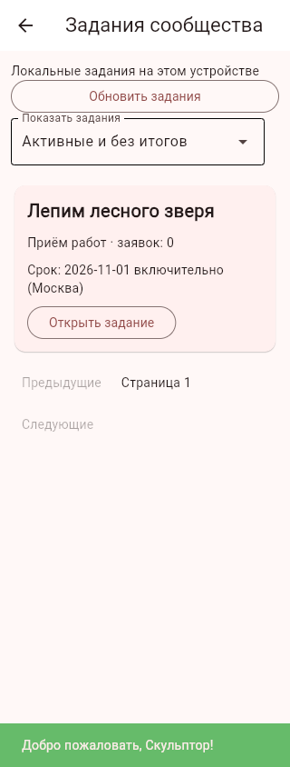
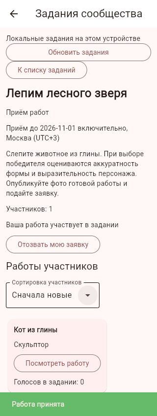
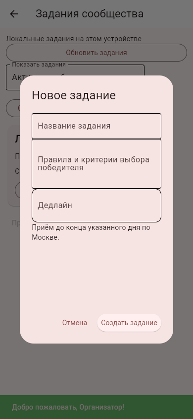

# Задания и конкурсы сообщества

Описание первой части №18. Дальнейшие изменения: [период, автоматический топ-3 и уведомления](challenge_results.md).

Добавлено 01.11.2026 (Москва), ветка `feature/community-challenges`, продолжение блока модерации №17.

## Как проверить

1. Войдите и откройте «Задания сообщества» на главной вкладке. Без API задания принадлежат только этому устройству; с API все действия выполняются на сервере. Ошибка сервера не переключает режим на локальный.
2. Администратор создаёт название, правила/критерии и обязательный дедлайн через календарь или ввод даты. Назначение первого администратора описано в [модерации](community_moderation.md); тестовый аккаунт автоматически не повышается.
3. Пользователь сначала публикует работу в ленте, затем выбирает её в задании. Одна заявка на пользователя в каждом задании. Повторная отправка той же работы не создаёт дубликат. До срока можно отозвать заявку и отправить другую.
4. Участники открывают публикации с фотографиями и комментариями, голосуют за чужие работы, сортируют список по новизне или голосам. Голоса конкурса отделены от лайков публикации. Повторный запрос постановки/снятия голоса безопасен, за собственную работу голосовать нельзя. Можно голосовать за несколько разных работ.
5. Дедлайн включает весь выбранный день по Москве (UTC+3). На следующий день приём заявок, отзыв и голосование закрываются, появляется статус «Ожидает итогов». Это проверяется при каждом действии независимо от того, обновил ли пользователь экран.
6. После срока администратор выбирает одного победителя из доступных незаблокированных участников либо завершает без победителя. До или после срока задание можно отменить. Итоги и отмена требуют объяснения, окончательны и попадают в журнал администратора вместе с созданием задания.
7. Фильтры: активные/ожидающие итогов, мои заявки, завершённые/отменённые. Списки и участники загружаются страницами по 50. Одновременно до 30 заданий с открытым приёмом.

При удалении публикации её заявки и конкурсные голоса удаляются каскадно. Удаление аккаунта удаляет заявки и его голоса. Итоговое объяснение остаётся, удалённая публикация победителя перестаёт отображаться. Личные проекты не затрагиваются. Снятие заявки удаляет накопленные голоса этой заявки; после повторной подачи они не восстанавливаются.

## Соответствие ТЗ и дальнейшие части

Это первый функциональный пакет по п. 4.1.22: создание администратором, участие, просмотр работ, отдельные голоса и сортировки, закрытие приёма и публикация итогов. Сейчас задание открывается сразу после создания, тематика и критерии задаются в правилах; пользователь явно выбирает уже опубликованную работу.

Остаются **дата отложенного старта и отдельная тематика**, автоматический тег при публикации/автоматический отбор по тегу и дате, сетка фотографий участников, автоматическое определение топ-3, призовые места и уведомления о них, статус участия непосредственно в профиле. Не следует считать п. 4.1.22 полностью закрытым. Социальные in-app/push/email уведомления и полный редизайн — следующие части плана. Автоматического фонового подведения итогов и почтовых рассылок в этом пакете нет.

## API и хранение

- `GET /community/challenges?mode=active|finished|mine&offset=0`
- `GET /community/challenges/{id}?offset=0&sort=new|votes`
- `PUT /community/challenges/{id}/entry` — `{postId}`
- `DELETE /community/challenges/{id}/entry`
- `PUT /community/challenges/{id}/votes/{postId}` — `{liked: true|false}`
- `POST /admin/challenges` — `{title,rules,deadline}` (дата ГГГГ-ММ-ДД)
- `PUT /admin/challenges/{id}` — `{state: finished|cancelled,reason,winnerPostId: null|id}`
- `GET /community/posts/{id}` — открытие одной работы без загрузки общей ленты.

Для заданий нужен вход. Пользователь берётся из действующей Bearer-сессии, права администратора сверяются с текущей БД, входные модели запрещают подмену автора. Локальный шлюз проверяет актуальность сессии и неизменность режима. Серверные ID публикаций передаются напрямую, не сравниваются с ID технической локальной записи аккаунта.

Таблицы `challenges`, `challengeEntries`, `challengeVotes` создаются при штатной инициализации существующей БД. Все записи участия/голосования/итогов выполняются в транзакциях; итог и журнал атомарны. JSON запросов заданий ограничен 32 КБ до разбора (в том числе для Unicode с экранированием), жалобы и остальное администрирование сохраняют лимит 8 КБ.

## Проверки

Автотесты проверяют HTTP-права, подмену автора, смену роли, сессии и переключение API, владельца публикации, уникальность и конкурентную подачу/голоса, дедлайны, отдельный счётчик, сортировку, отзыв, отмену, окончательные итоги, каскадное удаление и откат при сбое журнала. Отдельный тест настоящих контролов Flet проходит создание через форму, проверку даты, подачу, открытие публикации и выбор победителя.

На физическом Android новый раздел и выбор дат ещё не проверены; потребуется следующий контрольный APK. Исходное ТЗ не изменялось.

Браузерная проверка двумя учебными аккаунтами: подача заявки, просмотр публикации и отзыв на 320 px, форма администратора; ошибок страницы нет. Снимки сделаны на отдельной синтетической базе:

Полный набор: 327 проверок прошли; после правки отступов повторно пройден UI-сценарий. Исходники Android-пакета и состав архива проверены, APK в этом пакете не собирался.
