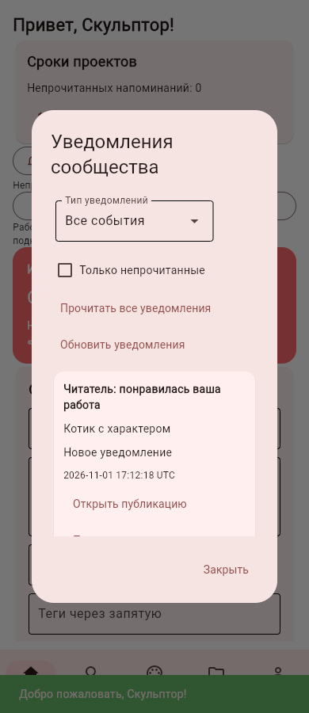
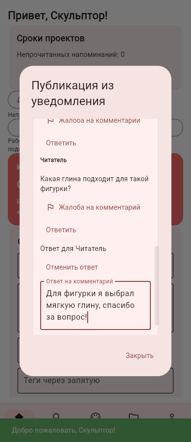
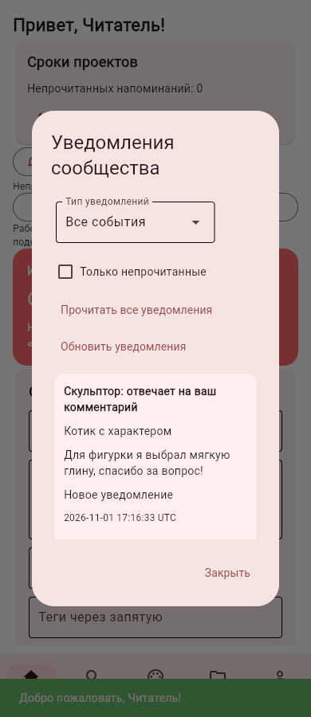
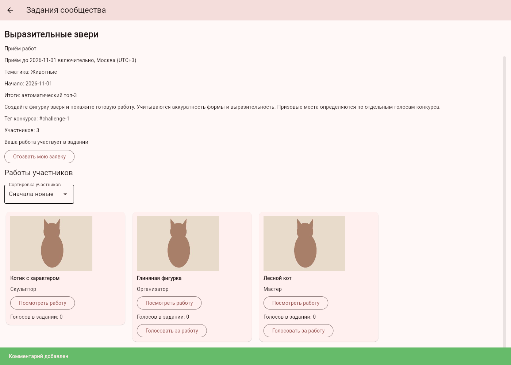
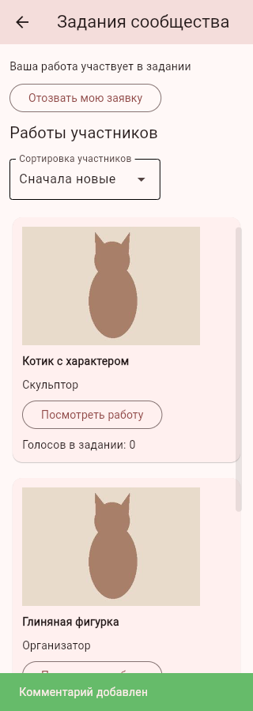
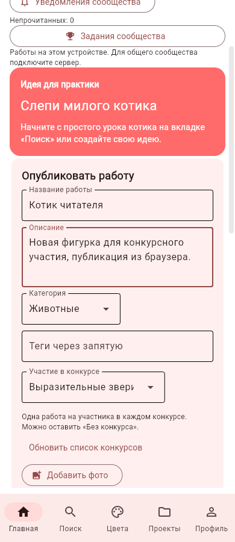

# Большой пакет сообщества: публикации, конкурсы, ответы, уведомления и лента

01.11.2026, Москва. Ветка `feature/community-complete-batch`, продолжение №19.

## Что изменилось для пользователя

1. **Публикация в конкурс.** На главной и в публикации проекта появился выбор принимающего работы конкурса. Создание публикации, фото, системного тега и заявки атомарно; при неверном сроке, переполнении тегов или повторной заявке новая публикация не остаётся в ленте. На странице конкурса кнопка «Опубликовать новую работу в конкурс» открывает форму с уже выбранным конкурсом.
2. **Теги и даты.** Системный тег вида `#challenge-12` соответствует ID текущего сообщества. Явная подача существующей публикации также добавляет тег. Принимаются только публикации, созданные в период конкурса по Москве. Старые принятые заявки сохраняются. Теги старых публикаций автоматически проверяются при чтении конкурсных разделов/уведомлений и серверной задачей перед подсчётом итогов; из нескольких подходящих публикаций автора выбирается первая по времени/ID. Полное совпадение тега обязательно, суффиксы вроде `#challenge-12-копия` не подходят.
3. **Отзыв без неожиданного возврата.** При отзыве снимается тег и сохраняется отказ от автоматического отбора. Даже если у автора была другая старая работа с тем же тегом, её не подадут вместо отозванной. Новая явная подача/конкурсная публикация снимает отказ. Голоса отозванной заявки не возвращаются.
4. **Сетка участников.** Вместо одного длинного списка показываются карточки с небольшими превью: одна колонка на телефоне, несколько на широком экране. Сохраняются голосование, сортировка, открытие полной работы и страницы по 50. Превью до 400×300 пикселей передаются отдельно; полные фотографии не загружаются ради каждой плитки.
5. **Ответы на комментарии.** Кнопка «Ответить» выбирает исходный комментарий, форма показывает адресата, ответ сохраняет связь. Родитель должен принадлежать той же публикации. Удаление родителя сохраняет текст ответа, снимая ссылку; удаление ответа снимает связанное уведомление. Вложенное древовидное раскрытие не добавлялось: ответы представлены обычными комментариями с подписью адресата.
6. **Уведомления об активности.** Лайк и комментарий уведомляют автора публикации, ответ — автора исходного комментария. При необходимости автор публикации получает отдельное событие комментария. Если адресаты совпадают, остаётся одно событие ответа; собственные действия не уведомляют самого пользователя. Запись события атомарна с действием. Повторное снятие/постановка лайка тем же пользователем не создаёт новые сообщения и не сбрасывает отметку прочтения. Это история события, не текущий индикатор наличия лайка.
7. **Общий личный список.** Призовые места и активность доступны на главной и в профиле через «Уведомления сообщества». Есть счётчик непрочитанных, фильтр типа, «Только непрочитанные», обновление, прочтение одного/всех и страницы по 50. Массовое прочтение применяется ко всем своим типам, даже если выбран фильтр. Переход открывает итоги или исходную публикацию с фото и обсуждением. Счётчик обновляется при открытии/обновлении раздела; фонового push нет.
8. **Лента и обсуждения порциями.** Главная загружает 12 публикаций за раз с «Показать ещё работы», поиском по названию/описанию/тегам, фильтром категории, сортировкой по новизне/популярности и своими работами. Обсуждение открывает 20 последних комментариев, следующие доступны кнопкой. Лайк обновляет кнопку на месте, сохраняя загруженные карточки и положение пользователя; перестановка по популярности происходит при обновлении ленты.

Уведомления создаются с учётом общей настройки профиля в момент события; старые остаются после выключения. Удаление материалов, участников и аккаунтов очищает либо скрывает связанные уведомления. Превью комментария читается из текущего материала, отдельная копия его текста в событиях не хранится. Почта и внешние сообщения не отправляются.

## Режимы и перенос

Все основные сценарии доступны локально и через API. ID конкурса принадлежит конкретной базе/серверу. При отправке старой локальной публикации на сервер служебные конкурсные теги убираются только из отправляемой копии: они не должны случайно подать работу в другой конкурс с совпавшим ID. Исходная местная публикация сохраняется.

Выбор конкурса в форме привязывается к текущей сессии. Повторная отправка публикации использует прежний механизм `requestId`, включая совместимость с хешами публикаций до добавления поля конкурса. API не принимает автора от клиента. Действующие сессии, права владельца, настройки и ограничения комментариев сохраняются.

## API и миграция

Новые/расширенные маршруты:

- `POST /community/posts`: необязательный `challengeId`; сохранение и заявка одной транзакцией.
- `POST /community/posts/{postId}/comments`: необязательный `replyToId`; при редактировании менять адресата нельзя.
- `GET /community/feed?mine=false&query=&category=Все&sort=new|popular&offset=0&limit=12` (до 50).
- `GET /community/posts/{postId}/comments-page?offset=0&limit=20` (до 50), последние первыми.
- `GET /community/photos/{photoId}?thumbnail=true` — небольшое JPEG-превью.
- `GET /community/notices?kind=all|award|like|comment|reply&unread=false&offset=0`.
- `GET /community/notice-summary` — общий счётчик и разбивка по типам.
- `PUT /community/notices/{noticeId}/read`.
- `PUT /community/notices-read-all`.

Старые маршруты списка работ/комментариев сохранены. Положительные ID уведомлений относятся к прежним призовым сообщениям и сохраняют свои значения; отрицательные обозначают новые события активности. Клиент передаёт идентификатор как непрозрачное значение. Ноль недопустим, все операции проверяют получателя.

Инициализация добавляет `postComments.replyToId`, таблицы `activityNotices` и `challengeOptOuts`, сохраняя комментарии/награды. Внутри публикации используется SAVEPOINT: отказ заявки не оставляет частично записанную работу даже у вызова в существующей транзакции. Удаления используют внешние ключи и штатную очистку данных аккаунта. Реальные пользовательские базы во время разработки не изменялись.

## Проверка

Проверяются выбор конкурса и повторы HTTP, откат фото/публикации/ключа повтора, теги/даты/лимиты и ложные совпадения, отбор старых работ, отзыв/новая явная подача, публикация проекта, ответы/адресаты/удаление, дедупликация лайков, настройки/фильтры/чужие уведомления/прочтение, миграция прежней схемы, старые хеши запросов, порционная лента/обсуждения/поиск/превью. UI-сценарии проходят форму с фото, выбор конкурса, догрузку ленты, ответы, счётчик и массовое прочтение. Отдельный настоящий сервер проверяет несовпадающие ID двух баз, публикацию/заявку/ответы/события/превью и перенос локальной копии без ложного конкурсного тега.

Пункты ТЗ 4.1.22 существенно дополнены. Пункт 4.1.23 пока закрыт частично: есть in-app призовые/социальные события и прежние личные напоминания. Остаются push при закрытом приложении, другие системные/учебные события, полноценное серверное развёртывание, общая Android-проверка и редизайн. Исходное ТЗ не менялось. Новый APK в этом пакете не собирался.

Проверка 01.11.2026: **357 тестов прошли**. В браузере два синтетических аккаунта прошли уведомление → публикация → ответ → сообщение другому аккаунту → массовое прочтение → конкурс → выбранный конкурс в форме → настоящая загрузка фото → публикация. В отдельной тестовой БД подтверждены одна заявка с системным тегом, ссылка ответа на родителя и отметки прочтения; внешние ключи целы. Ошибок страницы нет.

