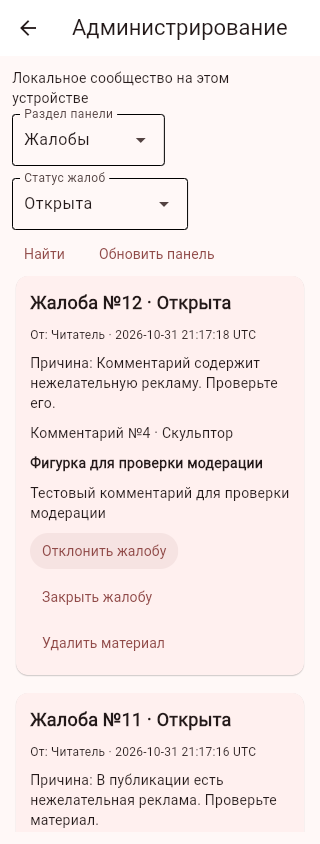
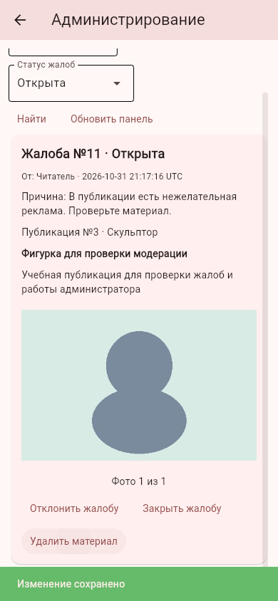
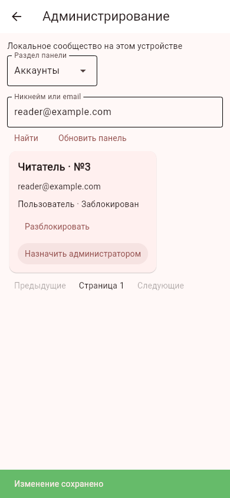
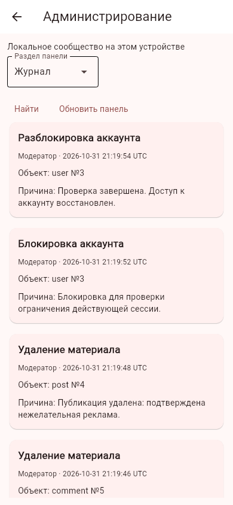

# Администрирование и модерация сообщества

Контрольный блок от 01.11.2026 (Москва), ветка `feature/community-moderation`, поверх #16. Пользователь подтвердил работу предыдущего пакета; это следующий блок по разделу администрирования и сообщества. Исходное ТЗ и его исторический срок не изменены. Новый APK не собирался.

## Жалобы и решения

У вошедшего пользователя в карточке публикации есть «Пожаловаться», у комментария — «Жалоба на комментарий». Обязательна причина от 10 до 500 символов. После отправки отображается подтверждение. Повторная жалоба от того же аккаунта на тот же материал возвращает прежний номер, включая конкурентные повторы. Максимум десять новых жалоб за последние сутки. Гость отправлять жалобы не может.

В профиле администратора есть «Администрирование». Раздел «Жалобы» показывает причину, автора жалобы, текст публикации/комментария, фото публикации и статус. Фильтры: открытые, рассмотренные, отклонённые и все. Можно отклонить жалобу, закрыть её после рассмотрения или удалить материал. Для каждого решения обязательна отдельная причина. Удаление материала закрывает все открытые жалобы на него; при удалении публикации закрываются также жалобы на её комментарии. Если автор сам удалил материал, жалобу можно закрыть с пояснением — её история не исчезает.

Администратору также доступны кнопки модераторского удаления прямо в ленте и комментариях. Удаление окончательное: удаление публикации убирает её фотографии, комментарии, лайки, прогресс читателей и ключи повторной отправки. Собственные проекты автора и ранее скопированные другими пользователями рецепты не затрагиваются. Восстановление удалённого материала и отдельный режим скрытия в этом блоке не добавлены.

## Аккаунты и роли

Раздел «Аккаунты» поддерживает поиск по никнейму/email, в том числе без учёта регистра кириллицы. Администратор может блокировать и разблокировать аккаунты, назначать роль `admin` или возвращать `user`. Нужна причина. Изменение роли или блокировки отзывает все сессии целевого аккаунта; после разблокировки/повышения нужно войти заново. Блокировка запрещает вход и новые действия аккаунта; решение об удалении его публикаций принимается отдельно.

Панель не разрешает менять собственную роль/блокировку. Проверка полномочий и ограничения активных администраторов выполняются внутри транзакции. Назначение администратора допускается только для подтверждённого незаблокированного аккаунта. Технические локальные записи серверных аккаунтов не показываются как управляемые аккаунты локального сообщества.

В API-режиме панель управляет серверными аккаунтами и использует их ID; локальный ID технической записи клиента не подставляется вместо server ID. Локальное сообщество и API не смешиваются. Сбой API не переключает панель на местную базу.

Пользовательские роли с отдельным набором разрешений, административное удаление аккаунта, email/push о блокировке и решении по жалобе, просмотр своих решений жалобщиком и конкурсы остаются открытыми требованиями. Этот блок закрывает базовую административную работу и модерацию; весь раздел ролей ТЗ не объявляется завершённым.

## Первое назначение администратора

Приложение не поставляет универсального администраторского пароля. Демонстрационный `test@email.com` остаётся обычным пользователем. Нужен существующий подтверждённый аккаунт и доступ владельца к правильной базе.

Команда из корня проекта (вместо `python` можно указать Python своего виртуального окружения):

```bash
python -m scripts.manage_admin --database /полный/путь/lepka_helper.db --email your@example.com
```

Для API укажите именно серверную `/полный/путь/accounts.db`, а не базу Flet-клиента. Для мобильного приложения роль обычно назначается на сервере с компьютера; самой команды в APK нет. Локальную демоверсию можно проверять с администратором в её базе на ПК.

Команда проверяет существование и схему базы, не создаёт аккаунтов, не меняет пароль и не отправляет писем. Назначение и отзыв старых сессий записываются транзакционно, в журнале источник — «Консоль». Повторное назначение уже действующему администратору не создаёт лишних событий. После команды войдите заново и откройте «Профиль» → «Администрирование».

## Журнал, данные и права

`moderationReports` хранит жалобы и решения, `adminAudit` — административные изменения: кто, когда, тип операции, тип/ID объекта и причина. Пароли, токены, изображения и полный удалённый материал в журнал не копируются. Время записей хранится и подписано UTC. Журнал постраничный, по 50 записей; жалобы и аккаунты тоже выводятся по 50. Кнопка следующей страницы при ровно 50 результатах может открыть пустую страницу — можно вернуться назад.

Удаление аккаунта обнуляет его внешние ссылки в жалобах/журнале, сохраняя историю. В журнале остаётся ник администратора на момент решения и введённые причины, о чём дополнено описание данных приложения. Сами удаления и соответствующая запись в журнале происходят одной транзакцией: если журнал не записался, материал не удаляется. Повторное удаление/закрытие не создаёт новых записей об успешном действии.

Локальный шлюз проверяет живую сессию. API принимает актёра из Bearer-сессии и заново проверяет актуальные роль, блокировку и подтверждение; actorId из тела не принимается. Ответы административного API помечены `Cache-Control: no-store`. Обычный пользователь получает 403, отсутствие/отозванная сессия — 401. Размер запросов решений и жалоб ограничен 8 КБ до разбора JSON, число/длина полей проверяются. Клиентские кнопки не заменяют серверную проверку.

## Проверки

314 автоматических тестов на временных данных: базовые сценарии приложения, HTTP-права, подмена actorId, дедупликация и лимит жалоб, удаление связанных данных, решения/журнал, откат при ошибке журнала, блокировка и отзыв токенов, смена роли, поиск кириллицы, удаление аккаунта с сохранением истории, bootstrap-команда, UI и устаревший обработчик после понижения роли.

Отдельный тест с настоящим API в другом процессе создаёт совпадение чужого server ID и своего local ID, блокирует именно серверный аккаунт и проверяет, что локальная техническая запись и её роль не изменились. Реальная почта не отправляется. Новые клиентские модули включены в подготовку Android, backend/команда/тесты — в контрольный ZIP. Физический Android для этого блока ещё требует проверки в следующем общем APK.

Проверка Chromium с настоящим Flet-сервером и двумя независимыми браузерными аккаунтами прошла: отправка жалоб на публикацию и комментарий, открытие панели из профиля, ширина 320 пикселей, удаление с причиной, поиск аккаунта, блокировка и завершение прежней сессии читателя, разблокировка и журнал. JavaScript-ошибок нет. Проверка SQLite подтверждает два решения, две записи об удалении, блокировку/разблокировку, отсутствие удалённых фото/комментариев и целостность связей. Все данные синтетические в отдельном каталоге.





