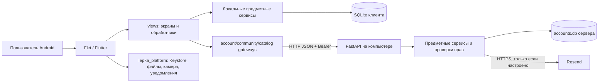

# Техническая архитектура

## Технологии и требования

| Компонент | Фактическая реализация |
|---|---|
| Язык | Python 3.12; финальная проверка на CPython 3.12.14 |
| UI | Flet 0.28.3, Material 3; веб-клиент для проверки и нативная Android-упаковка |
| Android-оболочка | Flutter 3.29.2, JDK 17, SDK target 35/min 28; ARM64; локальный `lepka_platform` |
| Видео | flet-video 0.1.1; MP4 без перекодирования |
| API | FastAPI 0.115.12, Starlette 0.46.2, Pydantic 2.11.4, Uvicorn 0.34.2 |
| HTTP клиента | requests 2.32.3; JSON, Bearer token; изображения в бинарных маршрутах/JSON base64 |
| Данные | sqlite3 стандартной библиотеки; явные SQL и транзакции, без ORM |
| Изображения | Pillow 12.3.0; встроенный DejaVuSans для экспорта |
| Тесты | unittest, временные базы, TestClient и отдельные HTTP-процессы; браузерная приёмка Playwright |

Версии серверных зависимостей находятся в `backend/requirements.txt`, клиентских — в `requirements.txt`. API metadata имеет самостоятельную версию `1.1`; она не равна версии APK. Полные 81 операция и схемы тел: [API_REFERENCE.md](API_REFERENCE.md), [OpenAPI](evidence/openapi.json).

Проверенная Android-цель — Android 9+ и arm64-v8a, не ARM32/x86. Требования к RAM и быстродействию минимального реального устройства здесь не измерялись. Для компьютера нужны Python 3.12, доступ к выбранному TCP-порту, место под SQLite/фото и браузер; для сборки дополнительно JDK/Flutter/Android SDK и интернет к репозиториям зависимостей. На защите компьютер и телефон находятся в одной сети; компьютер может быть подключён кабелем к тому же роутеру.

## Компоненты



Для веб-резерва вместо Android-оболочки используется `web_app.py` с маршрутами Flet, одноразовых загрузок/скачиваний и доступа к медиа. API и веб-клиент запускаются разными процессами и с разными каталогами данных. `database.DATABASE_PATH` — процессная переменная, не механизм нескольких одновременных серверных БД в одном процессе.

| Группа | Основные модули |
|---|---|
| Запуск и оформление | `main.py`, `web_app.py`, `app_paths.py`, `app_state.py`, `design_system.py`, `localization.py`, `interface_catalog.py` |
| Навигация | `views/home_view.py`, `views/discovery.py`, самостоятельные model/catalog/planner/challenge views |
| Аккаунт | `account_gateway.py`, `auth_service.py`, `account_security.py`, `password_service.py`, `remote_account_cache.py`, `device_session.py` |
| Проекты | `project_service.py`, `project_sharing.py`, `project_archive.py`, `project_planner.py`, `project_statistics.py`, `views/project_editor.py` |
| Цвет/фото | `color_service.py`, `color_export.py`, `color_photo.py`, `photo_service.py`, `photo_picker.py`, `reference_service.py`, `file_export.py` |
| Обучение/3D | `lesson_service.py`, `lesson_library.py`, `learning_assets.py`, `model_import.py`, `model_service.py`, `mesh_renderer.py`, `learning_catalog.py`, `catalog_*` |
| Сообщество | `community_gateway.py`, `post_service.py`, `feed_service.py`, `workshop_service.py`, `activity_service.py` |
| Конкурсы и права | `challenge_service.py`, `challenge_gateway.py`, `role_service.py`, `moderation_service.py`, `moderation_gateway.py` |
| Офлайн/перенос | `offline_access.py`, `community_cache.py`, `community_outbox.py`, `offline_mutations.py`, `personal_snapshot.py`, `personal_sync.py`, `personal_vault.py`, `personal_checkpoints.py` |
| Уведомления | `notification_center.py`, `personal_notices.py`, `device_notifications.py`, `delivery_settings.py`, `notification_mail.py` |

Полный AST-индекс 142 Python-файлов с назначением и признаками упаковки: [MODULE_INDEX.md](MODULE_INDEX.md). Наличие файла само по себе не означает активную функцию: часть старых views не входит в APK; `publicationDrafts` хранится для совместимости, но кнопок черновиков в текущем редакторе нет.

## Потоки работы

```mermaid
sequenceDiagram
  participant P as Flet
  participant API as FastAPI
  participant DB as SQLite сервера
  P->>P: Показать страницу загрузки поста
  P->>API: GET /community/posts/{id}/detail + token
  API->>DB: Один пост, 20 комментариев, фото и публичный снимок
  DB-->>API: Данные
  API-->>P: JSON + превью до 960 px
  P->>P: Проверить актуальность страницы и сессии
  P->>P: Показать карточку; повторные нажатия не дублируют запрос
```

Старый сервер 0.15/0.16 поддерживается запасным протоколом. Запись комментария, публикация и другие мутации отдельно проверяют сессию и права. Кнопка отправки блокируется до сетевой проверки, на сервере используются requestId/хеши и результаты повторных операций.

Для личного снимка клиент сравнивает контрольную сумму и ревизию, показывает конфликт и требует явного выбора. Замена создаёт страховочную копию и выполняется транзакционно. Это ручная синхронизация поддерживаемого набора, не автоматическое зеркало всей SQLite.

## Хранение и безопасность

- `LEPKA_DATA_DIR` или `FLET_APP_STORAGE_DATA` выбирает клиентский каталог; без них используется каталог исходников. Сервер получает `LEPKA_SERVER_DATA_DIR/accounts.db` через launcher. Клиентские и серверные userId сопоставляются явно.
- Пароль: PBKDF2-HMAC-SHA256, случайная соль, 100000 итераций; поддерживается проверка старых форматов. Токены/одноразовые коды в серверной базе хешируются, срок сессии — 12 часов; проверяются отзыв, блокировка и подтверждение email.
- Регистрация и смена email требуют почтового кода; срок регистрации 24 часа, восстановления/нового email 10 минут, 5 попыток кода, повторная отправка не чаще 60 секунд. Есть ограничения ошибочного входа и частоты комментариев.
- Android-серверная сессия: AES-GCM, ключ Android Keystore, закрытые SharedPreferences. Локальный тестовый токен сохраняется в закрытый файл приложения. Пароль не записывается. Веб/ПК не получают обещания нативного сохранения входа после закрытия.
- Авторизация API определяет владельца по Bearer, а не по переданному клиентом userId. Пользовательские роли проверяются сервером на каждой административной операции; видимость кнопок не является границей безопасности.
- Фото проверяются, ограничиваются размером и числом пикселей, нормализуются; пути из текстового поля не исполняются. ZIP/OBJ проверяются на traversal, квоты и допустимую геометрию. Медиа-каталог использует неизменяемые файлы по хешам.
- HTTP учебной сети передаёт пароль и токен без транспортного шифрования. Не публиковать сервер напрямую в интернет. Caddy/HTTPS предусмотрен конфигурацией, но не использован и не проверен как публичный продакшен в этой приёмке.
- SQLite, личные снимки, резервные копии и фото не зашифрованы целиком. Доступ ограничивается ОС и сервисными проверками владельца; SHA-256 обнаруживает повреждение, а не скрывает содержание.

## Надёжность и границы

Сеансы, очередь повторов, защищённое сохранение, обработка 401/сбоев сети и миграции проверены автотестами на отдельных базах. Контроль версий не даёт молча заменить новые личные данные старым снимком. Фоновое подведение итогов конкурсов и опциональная почтовая очередь выполняются сервером; локальные Android-напоминания используют `setAndAllowWhileIdle`, поэтому точное время зависит от ОС.

Однопроцессный SQLite-сервер подходит для выбранной учебной демонстрации. Нагрузочное соответствие всем численным требованиям ТЗ не измерялось. Запуск нескольких Uvicorn workers не входит в проверенную конфигурацию (`workers=1`).
