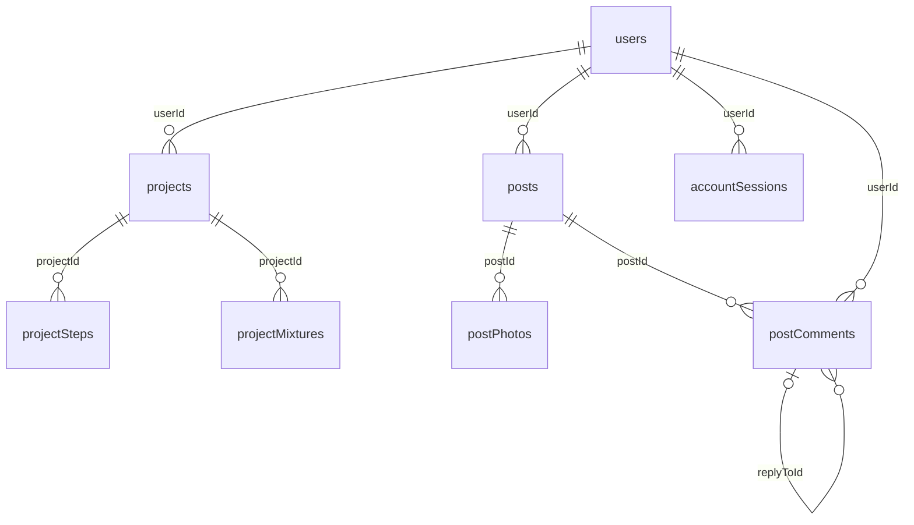

# База данных Lepka Helper

Схема снята после `initializeDatabase()` на новой изолированной SQLite: **58 прикладных таблиц**, **76 строк объявлений FK**. Пользовательские базы не открывались. Источник: [schema.json](evidence/schema.json), [полный DDL](evidence/schema.sql).

Клиент и сервер используют общий инициализатор, поэтому имеют одну структуру, но разные физические файлы и назначения данных. Клиент: `LEPKA_DATA_DIR/lepka_helper.db`; API: `LEPKA_SERVER_DATA_DIR/accounts.db`. Прямой синхронизации файлов нет. Сопоставление удалённых идентификаторов выполняется через remoteAccounts.

Скрипт включает `PRAGMA foreign_keys=ON` на каждом соединении, тайм-аут SQLite 30 секунд, транзакцию с откатом и закрытием соединения. Для конкурирующих записей применяются `BEGIN IMMEDIATE`, проверки версии/состава и ключи идемпотентности. Инициализация добавляет отсутствующие таблицы/поля; отдельной таблицы версий миграций нет. Проверка свежей базы: integrity_check = ok, нарушений FK = 0. Это не проверка пользовательского файла.

## Связи и хранение

Идентификаторы INTEGER/строковые ключи берутся из реального DDL. TEXT JSON — сериализованные документы, не дополнительные SQL-таблицы. Фото/аватары/файлы — BLOB. Дедлайн проекта вводится DD.MM.YYYY, даты конкурса хранятся ISO YYYY-MM-DD; служебные createdAt могут быть TEXT SQL CURRENT_TIMESTAMP или ISO UTC, expiresAt/lease — числовые Unix timestamps; не следует считать все поля дат одним форматом.

Не все логические ссылки объявлены FK: modelId/lessonId могут ссылаться на встроенный каталог в коде, targetId — на разные типы объектов, удалённые IDs принадлежат другой базе. Это отмечено общей архитектурой и не добавлено в ER как несуществующие SQL-ограничения.

Сжатые personalCheckpoints и JSON-снимки **не зашифрованы**; SHA-256 обнаруживает повреждение, но не заменяет шифрование. Закрытый каталог Android и шифрование серверного токена в Keystore не означают шифрование всей SQLite.

## ER-диаграммы

Полная диаграмма всех таблиц и объявленных FK: [ER_DIAGRAM.mmd](ER_DIAGRAM.mmd). Ниже — центральная часть; все остальные связи перечислены у таблиц.

## Все прикладные таблицы

### `accountCodes`

Хеши одноразовых кодов регистрации, восстановления и изменения email; сроки и число попыток.

| Поле | Тип SQLite | PK (позиция) | NOT NULL по DDL | DEFAULT |
|---|---|---:|---|---|
| `email` | TEXT | 1 | да | — |
| `purpose` | TEXT | 2 | да | — |
| `userId` | INTEGER | 0 | да | — |
| `codeHash` | TEXT | 0 | да | — |
| `expiresAt` | REAL | 0 | да | — |
| `sentAt` | REAL | 0 | да | — |
| `attempts` | INTEGER | 0 | да | 0 |

- FK `userId` → `users.userId`; DELETE NO ACTION, UPDATE NO ACTION.
- UNIQUE `sqlite_autoindex_accountCodes_1` (email, purpose); origin=pk.

### `accountEvents`

События аккаунта для контроля действий и ограничений.

| Поле | Тип SQLite | PK (позиция) | NOT NULL по DDL | DEFAULT |
|---|---|---:|---|---|
| `eventId` | INTEGER | 1 | нет | — |
| `userId` | INTEGER | 0 | да | — |
| `eventName` | TEXT | 0 | да | — |
| `createdAt` | TEXT | 0 | да | CURRENT_TIMESTAMP |

Объявленных FK нет.

### `accountSessions`

Хеши токенов активных сессий, владелец и срок действия.

| Поле | Тип SQLite | PK (позиция) | NOT NULL по DDL | DEFAULT |
|---|---|---:|---|---|
| `tokenHash` | TEXT | 1 | нет | — |
| `userId` | INTEGER | 0 | да | — |
| `expiresAt` | REAL | 0 | да | — |

- FK `userId` → `users.userId`; DELETE NO ACTION, UPDATE NO ACTION.
- UNIQUE `sqlite_autoindex_accountSessions_1` (tokenHash); origin=pk.

### `activityNotices`

Личные события лайков, комментариев и ответов.

| Поле | Тип SQLite | PK (позиция) | NOT NULL по DDL | DEFAULT |
|---|---|---:|---|---|
| `noticeId` | INTEGER | 1 | нет | — |
| `userId` | INTEGER | 0 | да | — |
| `actorId` | INTEGER | 0 | да | — |
| `kind` | TEXT | 0 | да | — |
| `postId` | INTEGER | 0 | да | — |
| `commentId` | INTEGER | 0 | нет | — |
| `eventKey` | TEXT | 0 | да | — |
| `isRead` | INTEGER | 0 | да | 0 |
| `createdAt` | TEXT | 0 | да | CURRENT_TIMESTAMP |

- FK `commentId` → `postComments.commentId`; DELETE CASCADE, UPDATE NO ACTION.
- FK `postId` → `posts.postId`; DELETE CASCADE, UPDATE NO ACTION.
- FK `actorId` → `users.userId`; DELETE CASCADE, UPDATE NO ACTION.
- FK `userId` → `users.userId`; DELETE CASCADE, UPDATE NO ACTION.
- INDEX `activityRecipient` (userId, noticeId); origin=c.
- UNIQUE `sqlite_autoindex_activityNotices_1` (userId, eventKey); origin=u.

### `adminAudit`

Журнал административных действий с причиной и сохранённым именем оператора.

| Поле | Тип SQLite | PK (позиция) | NOT NULL по DDL | DEFAULT |
|---|---|---:|---|---|
| `eventId` | INTEGER | 1 | нет | — |
| `actorId` | INTEGER | 0 | нет | — |
| `actorNickname` | TEXT | 0 | да | — |
| `action` | TEXT | 0 | да | — |
| `targetType` | TEXT | 0 | да | — |
| `targetId` | INTEGER | 0 | да | — |
| `reason` | TEXT | 0 | да | — |
| `createdAt` | TEXT | 0 | да | CURRENT_TIMESTAMP |

- FK `actorId` → `users.userId`; DELETE SET NULL, UPDATE NO ACTION.

### `challengeAwards`

Итоговые призовые места и голоса на момент подведения итогов.

| Поле | Тип SQLite | PK (позиция) | NOT NULL по DDL | DEFAULT |
|---|---|---:|---|---|
| `challengeId` | INTEGER | 1 | да | — |
| `place` | INTEGER | 2 | да | — |
| `postId` | INTEGER | 0 | нет | — |
| `userId` | INTEGER | 0 | нет | — |
| `votes` | INTEGER | 0 | да | — |

- FK `userId` → `users.userId`; DELETE SET NULL, UPDATE NO ACTION.
- FK `postId` → `posts.postId`; DELETE SET NULL, UPDATE NO ACTION.
- FK `challengeId` → `challenges.challengeId`; DELETE CASCADE, UPDATE NO ACTION.
- UNIQUE `sqlite_autoindex_challengeAwards_1` (challengeId, place); origin=pk.

### `challengeEntries`

Участники конкурса и связанная опубликованная работа.

| Поле | Тип SQLite | PK (позиция) | NOT NULL по DDL | DEFAULT |
|---|---|---:|---|---|
| `challengeId` | INTEGER | 1 | да | — |
| `userId` | INTEGER | 2 | да | — |
| `postId` | INTEGER | 0 | да | — |
| `createdAt` | TEXT | 0 | да | CURRENT_TIMESTAMP |

- FK `postId` → `posts.postId`; DELETE CASCADE, UPDATE NO ACTION.
- FK `userId` → `users.userId`; DELETE CASCADE, UPDATE NO ACTION.
- FK `challengeId` → `challenges.challengeId`; DELETE CASCADE, UPDATE NO ACTION.
- UNIQUE `sqlite_autoindex_challengeEntries_2` (challengeId, postId); origin=u.
- UNIQUE `sqlite_autoindex_challengeEntries_1` (challengeId, userId); origin=pk.

### `challengeOptOuts`

Отказ пользователя от участия, исключающий повторное автоматическое включение.

| Поле | Тип SQLite | PK (позиция) | NOT NULL по DDL | DEFAULT |
|---|---|---:|---|---|
| `challengeId` | INTEGER | 1 | да | — |
| `userId` | INTEGER | 2 | да | — |

- FK `userId` → `users.userId`; DELETE CASCADE, UPDATE NO ACTION.
- FK `challengeId` → `challenges.challengeId`; DELETE CASCADE, UPDATE NO ACTION.
- UNIQUE `sqlite_autoindex_challengeOptOuts_1` (challengeId, userId); origin=pk.

### `challengeVotes`

Учёт голосов за конкурсные работы.

| Поле | Тип SQLite | PK (позиция) | NOT NULL по DDL | DEFAULT |
|---|---|---:|---|---|
| `challengeId` | INTEGER | 1 | да | — |
| `postId` | INTEGER | 2 | да | — |
| `userId` | INTEGER | 3 | да | — |

- FK `userId` → `users.userId`; DELETE CASCADE, UPDATE NO ACTION.
- FK `challengeId` → `challengeEntries.challengeId`; DELETE CASCADE, UPDATE NO ACTION.
- FK `postId` → `challengeEntries.postId`; DELETE CASCADE, UPDATE NO ACTION.
- UNIQUE `sqlite_autoindex_challengeVotes_1` (challengeId, postId, userId); origin=pk.

### `challenges`

Задания сообщества, правила, календарь, состояние и режим итогов.

| Поле | Тип SQLite | PK (позиция) | NOT NULL по DDL | DEFAULT |
|---|---|---:|---|---|
| `challengeId` | INTEGER | 1 | нет | — |
| `title` | TEXT | 0 | да | — |
| `rules` | TEXT | 0 | да | — |
| `deadline` | TEXT | 0 | да | — |
| `state` | TEXT | 0 | да | 'open' |
| `createdBy` | INTEGER | 0 | нет | — |
| `winnerPostId` | INTEGER | 0 | нет | — |
| `result` | TEXT | 0 | да | '' |
| `createdAt` | TEXT | 0 | да | CURRENT_TIMESTAMP |
| `startsOn` | TEXT | 0 | да | '' |
| `theme` | TEXT | 0 | да | '' |
| `resultMode` | TEXT | 0 | да | 'manual' |

- FK `winnerPostId` → `posts.postId`; DELETE SET NULL, UPDATE NO ACTION.
- FK `createdBy` → `users.userId`; DELETE SET NULL, UPDATE NO ACTION.

### `colorMixtures`

Личная смесь: название, HEX, масса и нормализованный рецепт JSON.

| Поле | Тип SQLite | PK (позиция) | NOT NULL по DDL | DEFAULT |
|---|---|---:|---|---|
| `mixtureId` | INTEGER | 1 | нет | — |
| `userId` | INTEGER | 0 | да | — |
| `mixtureName` | TEXT | 0 | да | — |
| `resultHex` | TEXT | 0 | да | — |
| `totalWeight` | REAL | 0 | да | — |
| `recipeJson` | TEXT | 0 | да | — |
| `createdAt` | TEXT | 0 | да | CURRENT_TIMESTAMP |

- FK `userId` → `users.userId`; DELETE NO ACTION, UPDATE NO ACTION.

### `commentEvents`

Недавние отправки комментариев для ограничения частоты.

| Поле | Тип SQLite | PK (позиция) | NOT NULL по DDL | DEFAULT |
|---|---|---:|---|---|
| `userId` | INTEGER | 0 | да | — |
| `createdAt` | TEXT | 0 | да | CURRENT_TIMESTAMP |

- FK `userId` → `users.userId`; DELETE NO ACTION, UPDATE NO ACTION.
- INDEX `commentEventsUserTime` (userId, createdAt); origin=c.

### `communityActionReceipts`

Серверные результаты идемпотентных действий по requestId.

| Поле | Тип SQLite | PK (позиция) | NOT NULL по DDL | DEFAULT |
|---|---|---:|---|---|
| `userId` | INTEGER | 1 | да | — |
| `requestId` | TEXT | 2 | да | — |
| `kind` | TEXT | 0 | да | — |
| `payloadHash` | TEXT | 0 | да | — |
| `resultJson` | TEXT | 0 | да | — |

- FK `userId` → `users.userId`; DELETE CASCADE, UPDATE NO ACTION.
- UNIQUE `sqlite_autoindex_communityActionReceipts_1` (userId, requestId); origin=pk.

### `communityCache`

Локальные ответы сообщества, разделённые по аккаунту и адресу API.

| Поле | Тип SQLite | PK (позиция) | NOT NULL по DDL | DEFAULT |
|---|---|---:|---|---|
| `userId` | INTEGER | 1 | да | — |
| `apiUrl` | TEXT | 2 | да | — |
| `cacheKey` | TEXT | 3 | да | — |
| `contentJson` | TEXT | 0 | да | — |
| `updatedAt` | REAL | 0 | да | — |

- FK `userId` → `users.userId`; DELETE CASCADE, UPDATE NO ACTION.
- UNIQUE `sqlite_autoindex_communityCache_1` (userId, apiUrl, cacheKey); origin=pk.

### `communityNotices`

Уведомления о призовых местах конкурсов.

| Поле | Тип SQLite | PK (позиция) | NOT NULL по DDL | DEFAULT |
|---|---|---:|---|---|
| `noticeId` | INTEGER | 1 | нет | — |
| `userId` | INTEGER | 0 | да | — |
| `challengeId` | INTEGER | 0 | да | — |
| `place` | INTEGER | 0 | да | — |
| `isRead` | INTEGER | 0 | да | 0 |
| `createdAt` | TEXT | 0 | да | CURRENT_TIMESTAMP |

- FK `challengeId` → `challenges.challengeId`; DELETE CASCADE, UPDATE NO ACTION.
- FK `userId` → `users.userId`; DELETE CASCADE, UPDATE NO ACTION.
- UNIQUE `sqlite_autoindex_communityNotices_1` (userId, challengeId, place); origin=u.

### `communityOutbox`

Локальная очередь публикаций, лайков и комментариев с повтором и арендой обработки.

| Поле | Тип SQLite | PK (позиция) | NOT NULL по DDL | DEFAULT |
|---|---|---:|---|---|
| `requestId` | TEXT | 1 | нет | — |
| `userId` | INTEGER | 0 | да | — |
| `apiUrl` | TEXT | 0 | да | — |
| `serverUserId` | INTEGER | 0 | да | — |
| `kind` | TEXT | 0 | да | — |
| `payloadJson` | TEXT | 0 | да | — |
| `payloadHash` | TEXT | 0 | да | — |
| `state` | TEXT | 0 | да | 'pending' |
| `attempts` | INTEGER | 0 | да | 0 |
| `nextAttemptAt` | REAL | 0 | да | 0 |
| `leaseUntil` | REAL | 0 | да | 0 |
| `leaseToken` | TEXT | 0 | да | '' |
| `lastError` | TEXT | 0 | да | '' |
| `resultJson` | TEXT | 0 | нет | — |
| `createdAt` | REAL | 0 | да | — |

- FK `userId` → `users.userId`; DELETE CASCADE, UPDATE NO ACTION.
- UNIQUE `sqlite_autoindex_communityOutbox_1` (requestId); origin=pk.

### `communityRequests`

Серверные ключи повторной публикации и хеши тела запроса.

| Поле | Тип SQLite | PK (позиция) | NOT NULL по DDL | DEFAULT |
|---|---|---:|---|---|
| `userId` | INTEGER | 1 | да | — |
| `requestId` | TEXT | 2 | да | — |
| `payloadHash` | TEXT | 0 | да | — |
| `postId` | INTEGER | 0 | да | — |

- FK `postId` → `posts.postId`; DELETE CASCADE, UPDATE NO ACTION.
- FK `userId` → `users.userId`; DELETE CASCADE, UPDATE NO ACTION.
- UNIQUE `sqlite_autoindex_communityRequests_1` (userId, requestId); origin=pk.

### `customRoles`

Пользовательские роли и JSON-набор разрешений.

| Поле | Тип SQLite | PK (позиция) | NOT NULL по DDL | DEFAULT |
|---|---|---:|---|---|
| `roleCode` | TEXT | 1 | нет | — |
| `title` | TEXT | 0 | да | — |
| `permissionsJson` | TEXT | 0 | да | — |

- UNIQUE `sqlite_autoindex_customRoles_1` (roleCode); origin=pk.
Объявленных FK нет.

### `deliverySettings`

Персональные переключатели типов системных и почтовых уведомлений.

| Поле | Тип SQLite | PK (позиция) | NOT NULL по DDL | DEFAULT |
|---|---|---:|---|---|
| `userId` | INTEGER | 1 | нет | — |
| `deviceEnabled` | INTEGER | 0 | да | 0 |
| `likes` | INTEGER | 0 | да | 1 |
| `comments` | INTEGER | 0 | да | 1 |
| `replies` | INTEGER | 0 | да | 1 |
| `awards` | INTEGER | 0 | да | 1 |
| `projects` | INTEGER | 0 | да | 1 |
| `learning` | INTEGER | 0 | да | 1 |
| `emailEnabled` | INTEGER | 0 | да | 0 |

- FK `userId` → `users.userId`; DELETE CASCADE, UPDATE NO ACTION.

### `importedModels`

Личные OBJ/MTL-модели и вычисленное превью.

| Поле | Тип SQLite | PK (позиция) | NOT NULL по DDL | DEFAULT |
|---|---|---:|---|---|
| `modelId` | TEXT | 1 | нет | — |
| `userId` | INTEGER | 0 | да | — |
| `title` | TEXT | 0 | да | — |
| `objText` | TEXT | 0 | да | — |
| `materialText` | TEXT | 0 | да | — |
| `previewImage` | BLOB | 0 | да | — |
| `createdAt` | TEXT | 0 | да | CURRENT_TIMESTAMP |

- FK `userId` → `users.userId`; DELETE CASCADE, UPDATE NO ACTION.
- UNIQUE `sqlite_autoindex_importedModels_1` (modelId); origin=pk.

### `learningAssets`

Неизменяемые файлы редактируемого каталога, адресуемые по хешу.

| Поле | Тип SQLite | PK (позиция) | NOT NULL по DDL | DEFAULT |
|---|---|---:|---|---|
| `assetId` | TEXT | 1 | нет | — |
| `kind` | TEXT | 0 | да | — |
| `name` | TEXT | 0 | да | — |
| `mime` | TEXT | 0 | да | — |
| `content` | BLOB | 0 | да | — |
| `creatorId` | INTEGER | 0 | нет | — |
| `createdAt` | REAL | 0 | да | — |

- FK `creatorId` → `users.userId`; DELETE SET NULL, UPDATE NO ACTION.
- UNIQUE `sqlite_autoindex_learningAssets_1` (assetId); origin=pk.

### `learningCache`

Полные локальные версии материалов каталога вместе с файлами.

| Поле | Тип SQLite | PK (позиция) | NOT NULL по DDL | DEFAULT |
|---|---|---:|---|---|
| `userId` | INTEGER | 1 | нет | — |
| `apiUrl` | TEXT | 2 | да | — |
| `contentId` | TEXT | 3 | да | — |
| `revision` | INTEGER | 0 | да | — |
| `documentJson` | TEXT | 0 | да | — |
| `assetsJson` | TEXT | 0 | да | — |
| `byteCount` | INTEGER | 0 | да | — |
| `downloadedAt` | REAL | 0 | да | — |

- FK `userId` → `users.userId`; DELETE CASCADE, UPDATE NO ACTION.
- UNIQUE `sqlite_autoindex_learningCache_1` (userId, apiUrl, contentId); origin=pk.

### `learningCatalog`

Серверные документы уроков/моделей, редакция и состояние публикации.

| Поле | Тип SQLite | PK (позиция) | NOT NULL по DDL | DEFAULT |
|---|---|---:|---|---|
| `contentId` | TEXT | 1 | нет | — |
| `revision` | INTEGER | 0 | да | — |
| `state` | TEXT | 0 | да | — |
| `documentJson` | TEXT | 0 | да | — |
| `creatorId` | INTEGER | 0 | нет | — |
| `updatedAt` | TEXT | 0 | да | — |

- FK `creatorId` → `users.userId`; DELETE SET NULL, UPDATE NO ACTION.
- UNIQUE `sqlite_autoindex_learningCatalog_1` (contentId); origin=pk.

### `learningCatalogNotices`

События новых редакций подписанных материалов.

| Поле | Тип SQLite | PK (позиция) | NOT NULL по DDL | DEFAULT |
|---|---|---:|---|---|
| `userId` | INTEGER | 1 | нет | — |
| `apiUrl` | TEXT | 2 | да | — |
| `contentId` | TEXT | 3 | да | — |
| `revision` | INTEGER | 4 | да | — |
| `title` | TEXT | 0 | да | — |
| `isRead` | INTEGER | 0 | да | 0 |
| `createdAt` | TEXT | 0 | да | — |

- FK `userId` → `users.userId`; DELETE CASCADE, UPDATE NO ACTION.
- UNIQUE `sqlite_autoindex_learningCatalogNotices_1` (userId, apiUrl, contentId, revision); origin=pk.

### `learningIndex`

Локальный лёгкий индекс серверного каталога.

| Поле | Тип SQLite | PK (позиция) | NOT NULL по DDL | DEFAULT |
|---|---|---:|---|---|
| `userId` | INTEGER | 1 | нет | — |
| `apiUrl` | TEXT | 2 | да | — |
| `itemsJson` | TEXT | 0 | да | — |

- FK `userId` → `users.userId`; DELETE CASCADE, UPDATE NO ACTION.
- UNIQUE `sqlite_autoindex_learningIndex_1` (userId, apiUrl); origin=pk.

### `learningNotices`

Напоминания о продолжении встроенных уроков, прочтение и отсрочка.

| Поле | Тип SQLite | PK (позиция) | NOT NULL по DDL | DEFAULT |
|---|---|---:|---|---|
| `noticeId` | INTEGER | 1 | нет | — |
| `userId` | INTEGER | 0 | да | — |
| `lessonId` | INTEGER | 0 | да | — |
| `kind` | TEXT | 0 | да | — |
| `eventKey` | TEXT | 0 | да | — |
| `createdAt` | TEXT | 0 | да | — |
| `isRead` | INTEGER | 0 | да | 0 |
| `snoozedUntil` | TEXT | 0 | нет | — |

- FK `userId` → `users.userId`; DELETE CASCADE, UPDATE NO ACTION.
- UNIQUE `sqlite_autoindex_learningNotices_1` (userId, eventKey); origin=u.

### `learningPersonal`

Локальные отметки, избранное и заметки редактируемого каталога; отложенная статистика.

| Поле | Тип SQLite | PK (позиция) | NOT NULL по DDL | DEFAULT |
|---|---|---:|---|---|
| `userId` | INTEGER | 1 | нет | — |
| `apiUrl` | TEXT | 2 | да | — |
| `contentId` | TEXT | 3 | да | — |
| `revision` | INTEGER | 0 | да | — |
| `checkedJson` | TEXT | 0 | да | '[]' |
| `favorite` | INTEGER | 0 | да | 0 |
| `note` | TEXT | 0 | да | '' |
| `viewPending` | INTEGER | 0 | да | 1 |
| `completePending` | INTEGER | 0 | да | 0 |

- FK `userId` → `users.userId`; DELETE CASCADE, UPDATE NO ACTION.
- UNIQUE `sqlite_autoindex_learningPersonal_1` (userId, apiUrl, contentId); origin=pk.

### `learningSubscriptions`

Подписки аккаунта на категории каталога.

| Поле | Тип SQLite | PK (позиция) | NOT NULL по DDL | DEFAULT |
|---|---|---:|---|---|
| `userId` | INTEGER | 1 | нет | — |
| `apiUrl` | TEXT | 2 | да | — |
| `category` | TEXT | 3 | да | — |

- FK `userId` → `users.userId`; DELETE CASCADE, UPDATE NO ACTION.
- UNIQUE `sqlite_autoindex_learningSubscriptions_1` (userId, apiUrl, category); origin=pk.

### `learningUsage`

Серверная статистика просмотров и завершения редакций.

| Поле | Тип SQLite | PK (позиция) | NOT NULL по DDL | DEFAULT |
|---|---|---:|---|---|
| `userId` | INTEGER | 1 | нет | — |
| `contentId` | TEXT | 2 | нет | — |
| `revision` | INTEGER | 3 | да | — |
| `viewedAt` | TEXT | 0 | да | — |
| `completedAt` | TEXT | 0 | нет | — |

- FK `contentId` → `learningCatalog.contentId`; DELETE CASCADE, UPDATE NO ACTION.
- FK `userId` → `users.userId`; DELETE CASCADE, UPDATE NO ACTION.
- UNIQUE `sqlite_autoindex_learningUsage_1` (userId, contentId, revision); origin=pk.

### `lessonFavorites`

Избранные встроенные уроки.

| Поле | Тип SQLite | PK (позиция) | NOT NULL по DDL | DEFAULT |
|---|---|---:|---|---|
| `userId` | INTEGER | 1 | да | — |
| `lessonId` | INTEGER | 2 | да | — |
| `savedAt` | TEXT | 0 | да | CURRENT_TIMESTAMP |

- FK `userId` → `users.userId`; DELETE NO ACTION, UPDATE NO ACTION.
- UNIQUE `sqlite_autoindex_lessonFavorites_1` (userId, lessonId); origin=pk.

### `lessonNotes`

Заметки к встроенным урокам.

| Поле | Тип SQLite | PK (позиция) | NOT NULL по DDL | DEFAULT |
|---|---|---:|---|---|
| `userId` | INTEGER | 1 | да | — |
| `lessonId` | INTEGER | 2 | да | — |
| `noteText` | TEXT | 0 | да | — |
| `updatedAt` | TEXT | 0 | да | CURRENT_TIMESTAMP |

- FK `userId` → `users.userId`; DELETE NO ACTION, UPDATE NO ACTION.
- UNIQUE `sqlite_autoindex_lessonNotes_1` (userId, lessonId); origin=pk.

### `lessonProgress`

Индексы выполненных шагов/материалов встроенного урока в JSON.

| Поле | Тип SQLite | PK (позиция) | NOT NULL по DDL | DEFAULT |
|---|---|---:|---|---|
| `userId` | INTEGER | 1 | да | — |
| `lessonId` | INTEGER | 2 | да | — |
| `stateJson` | TEXT | 0 | да | — |
| `updatedAt` | TEXT | 0 | да | CURRENT_TIMESTAMP |

- FK `userId` → `users.userId`; DELETE NO ACTION, UPDATE NO ACTION.
- UNIQUE `sqlite_autoindex_lessonProgress_1` (userId, lessonId); origin=pk.

### `localPostExports`

Соответствие локальной публикации её серверной копии и ключ повторной отправки.

| Поле | Тип SQLite | PK (позиция) | NOT NULL по DDL | DEFAULT |
|---|---|---:|---|---|
| `apiUrl` | TEXT | 1 | да | — |
| `userId` | INTEGER | 2 | да | — |
| `localPostId` | INTEGER | 3 | да | — |
| `requestId` | TEXT | 0 | да | — |
| `serverPostId` | INTEGER | 0 | нет | — |

- FK `localPostId` → `posts.postId`; DELETE CASCADE, UPDATE NO ACTION.
- FK `userId` → `users.userId`; DELETE CASCADE, UPDATE NO ACTION.
- UNIQUE `sqlite_autoindex_localPostExports_1` (apiUrl, userId, localPostId); origin=pk.

### `modelFavorites`

Избранные модели по строковому идентификатору.

| Поле | Тип SQLite | PK (позиция) | NOT NULL по DDL | DEFAULT |
|---|---|---:|---|---|
| `userId` | INTEGER | 1 | да | — |
| `modelId` | TEXT | 2 | да | — |

- FK `userId` → `users.userId`; DELETE NO ACTION, UPDATE NO ACTION.
- UNIQUE `sqlite_autoindex_modelFavorites_1` (userId, modelId); origin=pk.

### `moderationReports`

Жалобы на публикации/комментарии, причина, решение и ответственный.

| Поле | Тип SQLite | PK (позиция) | NOT NULL по DDL | DEFAULT |
|---|---|---:|---|---|
| `reportId` | INTEGER | 1 | нет | — |
| `reporterId` | INTEGER | 0 | нет | — |
| `targetType` | TEXT | 0 | да | — |
| `targetId` | INTEGER | 0 | да | — |
| `reason` | TEXT | 0 | да | — |
| `status` | TEXT | 0 | да | 'open' |
| `resolution` | TEXT | 0 | да | '' |
| `resolvedBy` | INTEGER | 0 | нет | — |
| `createdAt` | TEXT | 0 | да | CURRENT_TIMESTAMP |
| `resolvedAt` | TEXT | 0 | нет | — |

- FK `resolvedBy` → `users.userId`; DELETE SET NULL, UPDATE NO ACTION.
- FK `reporterId` → `users.userId`; DELETE SET NULL, UPDATE NO ACTION.
- UNIQUE `sqlite_autoindex_moderationReports_1` (reporterId, targetType, targetId); origin=u.

### `notificationMailQueue`

Очередь почтовых событий с арендой обработки и повторными попытками.

| Поле | Тип SQLite | PK (позиция) | NOT NULL по DDL | DEFAULT |
|---|---|---:|---|---|
| `mailId` | TEXT | 1 | нет | — |
| `userId` | INTEGER | 0 | да | — |
| `email` | TEXT | 0 | да | — |
| `eventKey` | TEXT | 0 | да | — |
| `subject` | TEXT | 0 | да | — |
| `body` | TEXT | 0 | да | — |
| `state` | TEXT | 0 | да | 'pending' |
| `attempts` | INTEGER | 0 | да | 0 |
| `nextAttempt` | REAL | 0 | да | 0 |
| `leaseUntil` | REAL | 0 | да | 0 |
| `createdAt` | REAL | 0 | да | — |
| `lastError` | TEXT | 0 | да | '' |

- FK `userId` → `users.userId`; DELETE CASCADE, UPDATE NO ACTION.
- UNIQUE `sqlite_autoindex_notificationMailQueue_1` (mailId); origin=pk.

### `notificationMailState`

Нижняя граница сбора почтовых событий пользователя.

| Поле | Тип SQLite | PK (позиция) | NOT NULL по DDL | DEFAULT |
|---|---|---:|---|---|
| `userId` | INTEGER | 1 | нет | — |
| `since` | TEXT | 0 | да | — |

- FK `userId` → `users.userId`; DELETE CASCADE, UPDATE NO ACTION.

### `personalCheckpoints`

До пяти последних сжатых полных личных копий с SHA-256.

| Поле | Тип SQLite | PK (позиция) | NOT NULL по DDL | DEFAULT |
|---|---|---:|---|---|
| `checkpointId` | TEXT | 1 | нет | — |
| `userId` | INTEGER | 0 | да | — |
| `title` | TEXT | 0 | да | — |
| `content` | BLOB | 0 | да | — |
| `checksum` | TEXT | 0 | да | — |
| `createdAt` | TEXT | 0 | да | CURRENT_TIMESTAMP |

- FK `userId` → `users.userId`; DELETE CASCADE, UPDATE NO ACTION.
- UNIQUE `sqlite_autoindex_personalCheckpoints_1` (checkpointId); origin=pk.

### `personalNoticeSettings`

Настройки локальных напоминаний о проектах и обучении.

| Поле | Тип SQLite | PK (позиция) | NOT NULL по DDL | DEFAULT |
|---|---|---:|---|---|
| `userId` | INTEGER | 1 | нет | — |
| `projectsEnabled` | INTEGER | 0 | да | 1 |
| `lessonsEnabled` | INTEGER | 0 | да | 1 |
| `resumeDays` | INTEGER | 0 | да | 3 |

- FK `userId` → `users.userId`; DELETE CASCADE, UPDATE NO ACTION.

### `personalSyncState`

Локальная база сравнения ревизий личного снимка и ожидающая операция.

| Поле | Тип SQLite | PK (позиция) | NOT NULL по DDL | DEFAULT |
|---|---|---:|---|---|
| `userId` | INTEGER | 1 | да | — |
| `apiUrl` | TEXT | 2 | да | — |
| `revision` | INTEGER | 0 | да | 0 |
| `checksum` | TEXT | 0 | да | '' |
| `pending` | INTEGER | 0 | да | 0 |

- FK `userId` → `users.userId`; DELETE CASCADE, UPDATE NO ACTION.
- UNIQUE `sqlite_autoindex_personalSyncState_1` (userId, apiUrl); origin=pk.

### `personalVault`

Текущая серверная версия личного снимка пользователя.

| Поле | Тип SQLite | PK (позиция) | NOT NULL по DDL | DEFAULT |
|---|---|---:|---|---|
| `userId` | INTEGER | 1 | нет | — |
| `revision` | INTEGER | 0 | да | — |
| `checksum` | TEXT | 0 | да | — |
| `snapshotJson` | TEXT | 0 | да | — |
| `deviceId` | TEXT | 0 | да | — |
| `updatedAt` | TEXT | 0 | да | CURRENT_TIMESTAMP |

- FK `userId` → `users.userId`; DELETE CASCADE, UPDATE NO ACTION.

### `personalVaultHistory`

История серверных личных снимков.

| Поле | Тип SQLite | PK (позиция) | NOT NULL по DDL | DEFAULT |
|---|---|---:|---|---|
| `userId` | INTEGER | 1 | да | — |
| `revision` | INTEGER | 2 | да | — |
| `checksum` | TEXT | 0 | да | — |
| `snapshotJson` | TEXT | 0 | да | — |
| `deviceId` | TEXT | 0 | да | — |
| `updatedAt` | TEXT | 0 | да | — |

- FK `userId` → `users.userId`; DELETE CASCADE, UPDATE NO ACTION.
- UNIQUE `sqlite_autoindex_personalVaultHistory_1` (userId, revision); origin=pk.

### `postComments`

Комментарии и ответы через self-FK replyToId.

| Поле | Тип SQLite | PK (позиция) | NOT NULL по DDL | DEFAULT |
|---|---|---:|---|---|
| `commentId` | INTEGER | 1 | нет | — |
| `postId` | INTEGER | 0 | да | — |
| `userId` | INTEGER | 0 | да | — |
| `commentText` | TEXT | 0 | да | — |
| `createdAt` | TEXT | 0 | да | CURRENT_TIMESTAMP |
| `replyToId` | INTEGER | 0 | нет | — |

- FK `userId` → `users.userId`; DELETE NO ACTION, UPDATE NO ACTION.
- FK `postId` → `posts.postId`; DELETE NO ACTION, UPDATE NO ACTION.
- FK `replyToId` → `postComments.commentId`; DELETE SET NULL, UPDATE NO ACTION.

### `postLikes`

Лайки пользователя под публикацией.

| Поле | Тип SQLite | PK (позиция) | NOT NULL по DDL | DEFAULT |
|---|---|---:|---|---|
| `likeId` | INTEGER | 1 | нет | — |
| `postId` | INTEGER | 0 | да | — |
| `userId` | INTEGER | 0 | да | — |
| `createdAt` | TEXT | 0 | да | CURRENT_TIMESTAMP |

- FK `userId` → `users.userId`; DELETE NO ACTION, UPDATE NO ACTION.
- FK `postId` → `posts.postId`; DELETE NO ACTION, UPDATE NO ACTION.
- UNIQUE `sqlite_autoindex_postLikes_1` (postId, userId); origin=u.

### `postPhotos`

Упорядоченные бинарные фотографии публичной работы.

| Поле | Тип SQLite | PK (позиция) | NOT NULL по DDL | DEFAULT |
|---|---|---:|---|---|
| `photoId` | INTEGER | 1 | нет | — |
| `postId` | INTEGER | 0 | да | — |
| `position` | INTEGER | 0 | да | — |
| `imageData` | BLOB | 0 | да | — |

- FK `postId` → `posts.postId`; DELETE NO ACTION, UPDATE NO ACTION.
- UNIQUE `sqlite_autoindex_postPhotos_1` (postId, position); origin=u.

### `posts`

Публикации; публичный снимок проекта хранится отдельно в projectDetailsJson.

| Поле | Тип SQLite | PK (позиция) | NOT NULL по DDL | DEFAULT |
|---|---|---:|---|---|
| `postId` | INTEGER | 1 | нет | — |
| `userId` | INTEGER | 0 | да | — |
| `titleText` | TEXT | 0 | да | — |
| `descriptionText` | TEXT | 0 | да | — |
| `categoryName` | TEXT | 0 | да | — |
| `tagsText` | TEXT | 0 | нет | — |
| `likesCount` | INTEGER | 0 | да | 0 |
| `createdAt` | TEXT | 0 | да | CURRENT_TIMESTAMP |
| `isDeleted` | INTEGER | 0 | да | 0 |
| `projectDetailsJson` | TEXT | 0 | да | '' |

- FK `userId` → `users.userId`; DELETE NO ACTION, UPDATE NO ACTION.

### `projectMixtures`

Копии рецептов, прикреплённые к личному проекту.

| Поле | Тип SQLite | PK (позиция) | NOT NULL по DDL | DEFAULT |
|---|---|---:|---|---|
| `projectMixtureId` | INTEGER | 1 | нет | — |
| `projectId` | INTEGER | 0 | да | — |
| `mixtureJson` | TEXT | 0 | да | — |

- FK `projectId` → `projects.projectId`; DELETE NO ACTION, UPDATE NO ACTION.

### `projectReminders`

События сроков проектов с прочтением.

| Поле | Тип SQLite | PK (позиция) | NOT NULL по DDL | DEFAULT |
|---|---|---:|---|---|
| `reminderId` | INTEGER | 1 | нет | — |
| `userId` | INTEGER | 0 | да | — |
| `projectId` | INTEGER | 0 | да | — |
| `deadlineDate` | TEXT | 0 | да | — |
| `kind` | TEXT | 0 | да | — |
| `generatedDate` | TEXT | 0 | да | — |
| `isRead` | INTEGER | 0 | да | 0 |

- FK `projectId` → `projects.projectId`; DELETE CASCADE, UPDATE NO ACTION.
- FK `userId` → `users.userId`; DELETE CASCADE, UPDATE NO ACTION.
- UNIQUE `sqlite_autoindex_projectReminders_1` (userId, projectId, deadlineDate, kind); origin=u.

### `projectSteps`

Этапы личного проекта: заголовок в историческом поле stepDescription, описание detailsText, порядок, фото и отметка.

| Поле | Тип SQLite | PK (позиция) | NOT NULL по DDL | DEFAULT |
|---|---|---:|---|---|
| `stepId` | INTEGER | 1 | нет | — |
| `projectId` | INTEGER | 0 | да | — |
| `stepDescription` | TEXT | 0 | да | — |
| `isCompleted` | INTEGER | 0 | да | 0 |
| `createdAt` | TEXT | 0 | да | CURRENT_TIMESTAMP |
| `photoImage` | BLOB | 0 | нет | — |
| `detailsText` | TEXT | 0 | да | '' |
| `sortOrder` | INTEGER | 0 | да | 0 |

- FK `projectId` → `projects.projectId`; DELETE NO ACTION, UPDATE NO ACTION.

### `projects`

Личные проекты с категорией, дедлайном, заметками, прогрессом, финальным фото и отдельным завершением.

| Поле | Тип SQLite | PK (позиция) | NOT NULL по DDL | DEFAULT |
|---|---|---:|---|---|
| `projectId` | INTEGER | 1 | нет | — |
| `userId` | INTEGER | 0 | да | — |
| `projectName` | TEXT | 0 | да | — |
| `categoryName` | TEXT | 0 | да | — |
| `deadlineDate` | TEXT | 0 | нет | — |
| `descriptionText` | TEXT | 0 | нет | — |
| `progressPercent` | REAL | 0 | да | 0 |
| `createdAt` | TEXT | 0 | да | CURRENT_TIMESTAMP |
| `finalPhotoImage` | BLOB | 0 | нет | — |
| `isFinished` | INTEGER | 0 | да | 0 |
| `completedAt` | TEXT | 0 | нет | — |

- FK `userId` → `users.userId`; DELETE NO ACTION, UPDATE NO ACTION.

### `publicationDrafts`

Ранее сохранённые черновики. Кнопки удалены из актуальной формы, данные сохранены.

| Поле | Тип SQLite | PK (позиция) | NOT NULL по DDL | DEFAULT |
|---|---|---:|---|---|
| `draftId` | TEXT | 1 | нет | — |
| `userId` | INTEGER | 0 | да | — |
| `apiUrl` | TEXT | 0 | да | — |
| `payloadJson` | TEXT | 0 | да | — |
| `updatedAt` | REAL | 0 | да | — |

- FK `userId` → `users.userId`; DELETE CASCADE, UPDATE NO ACTION.
- UNIQUE `sqlite_autoindex_publicationDrafts_1` (draftId); origin=pk.

### `referenceImages`

Личные PNG-фотореференсы.

| Поле | Тип SQLite | PK (позиция) | NOT NULL по DDL | DEFAULT |
|---|---|---:|---|---|
| `referenceId` | TEXT | 1 | нет | — |
| `userId` | INTEGER | 0 | да | — |
| `apiUrl` | TEXT | 0 | да | — |
| `title` | TEXT | 0 | да | — |
| `image` | BLOB | 0 | да | — |
| `createdAt` | REAL | 0 | да | — |

- FK `userId` → `users.userId`; DELETE CASCADE, UPDATE NO ACTION.
- UNIQUE `sqlite_autoindex_referenceImages_1` (referenceId); origin=pk.

### `remoteAccounts`

Связь серверного userId с локальной технической записью пользователя.

| Поле | Тип SQLite | PK (позиция) | NOT NULL по DDL | DEFAULT |
|---|---|---:|---|---|
| `apiUrl` | TEXT | 1 | да | — |
| `remoteUserId` | INTEGER | 2 | да | — |
| `localUserId` | INTEGER | 0 | да | — |
| `displayNickname` | TEXT | 0 | да | — |

- FK `localUserId` → `users.userId`; DELETE NO ACTION, UPDATE NO ACTION.
- UNIQUE `sqlite_autoindex_remoteAccounts_2` (apiUrl, remoteUserId); origin=pk.
- UNIQUE `sqlite_autoindex_remoteAccounts_1` (localUserId); origin=u.

### `remoteProfileCache`

Последний профиль выбранного серверного аккаунта для ограниченного офлайн-режима.

| Поле | Тип SQLite | PK (позиция) | NOT NULL по DDL | DEFAULT |
|---|---|---:|---|---|
| `userId` | INTEGER | 1 | да | — |
| `apiUrl` | TEXT | 2 | да | — |
| `profileJson` | TEXT | 0 | да | — |

- FK `userId` → `users.userId`; DELETE CASCADE, UPDATE NO ACTION.
- UNIQUE `sqlite_autoindex_remoteProfileCache_1` (userId, apiUrl); origin=pk.

### `remoteSessionBindings`

Привязка хеша удалённого токена к серверу и локальному владельцу.

| Поле | Тип SQLite | PK (позиция) | NOT NULL по DDL | DEFAULT |
|---|---|---:|---|---|
| `tokenHash` | TEXT | 1 | нет | — |
| `apiUrl` | TEXT | 0 | да | — |
| `localUserId` | INTEGER | 0 | да | — |

- FK `localUserId` → `users.userId`; DELETE NO ACTION, UPDATE NO ACTION.
- UNIQUE `sqlite_autoindex_remoteSessionBindings_1` (tokenHash); origin=pk.

### `searchHistory`

Последние поисковые запросы без изменения пользовательского написания.

| Поле | Тип SQLite | PK (позиция) | NOT NULL по DDL | DEFAULT |
|---|---|---:|---|---|
| `userId` | INTEGER | 1 | да | — |
| `queryKey` | TEXT | 2 | да | — |
| `queryText` | TEXT | 0 | да | — |
| `lastUsed` | INTEGER | 0 | да | — |

- FK `userId` → `users.userId`; DELETE NO ACTION, UPDATE NO ACTION.
- UNIQUE `sqlite_autoindex_searchHistory_1` (userId, queryKey); origin=pk.

### `users`

Аккаунты, профиль, предпочтения, ограничения входа; на клиенте также технические записи удалённых аккаунтов.

| Поле | Тип SQLite | PK (позиция) | NOT NULL по DDL | DEFAULT |
|---|---|---:|---|---|
| `userId` | INTEGER | 1 | нет | — |
| `email` | TEXT | 0 | да | — |
| `passwordHash` | TEXT | 0 | да | — |
| `passwordSalt` | TEXT | 0 | да | — |
| `nickname` | TEXT | 0 | да | — |
| `roleName` | TEXT | 0 | да | 'user' |
| `isBlocked` | INTEGER | 0 | да | 0 |
| `createdAt` | TEXT | 0 | да | CURRENT_TIMESTAMP |
| `emailVerified` | INTEGER | 0 | да | 1 |
| `loginFailures` | INTEGER | 0 | да | 0 |
| `loginBlockedUntil` | REAL | 0 | да | 0 |
| `passwordFailures` | INTEGER | 0 | да | 0 |
| `passwordBlockedUntil` | REAL | 0 | да | 0 |
| `bioText` | TEXT | 0 | нет | '' |
| `ageCategory` | TEXT | 0 | нет | 'Взрослый 18+' |
| `favoriteColorsJson` | TEXT | 0 | нет | '[]' |
| `themeMode` | TEXT | 0 | нет | 'light' |
| `languageCode` | TEXT | 0 | нет | 'ru' |
| `notificationsEnabled` | INTEGER | 0 | нет | 1 |
| `avatarPath` | TEXT | 0 | нет | '' |
| `avatarImage` | BLOB | 0 | нет | — |

- UNIQUE `sqlite_autoindex_users_2` (nickname); origin=u.
- UNIQUE `sqlite_autoindex_users_1` (email); origin=u.
Объявленных FK нет.

### `workshopProgress`

Прогресс опубликованного мастер-класса.

| Поле | Тип SQLite | PK (позиция) | NOT NULL по DDL | DEFAULT |
|---|---|---:|---|---|
| `userId` | INTEGER | 1 | да | — |
| `postId` | INTEGER | 2 | да | — |
| `stateJson` | TEXT | 0 | да | — |

- FK `postId` → `posts.postId`; DELETE CASCADE, UPDATE NO ACTION.
- FK `userId` → `users.userId`; DELETE CASCADE, UPDATE NO ACTION.
- UNIQUE `sqlite_autoindex_workshopProgress_1` (userId, postId); origin=pk.

## Служебная таблица SQLite

`sqlite_sequence(name, seq)` создаётся SQLite для AUTOINCREMENT и не является прикладной моделью. Служебные автоматические индексы перечислены у таблиц. Фактическое число триггеров: 0. Полные CHECK, UNIQUE, составные PK и действия FK приведены в DDL; правила длины, диапазонов, владельца и содержимого JSON дополнительно проверяются Python-сервисами.

SQLite допускает особенности nullable PK в обычных rowid-таблицах: колонка NOT NULL в таблицах выше отражает именно PRAGMA, а не выдуманное ограничение. Валидаторы приложения обязательны.
