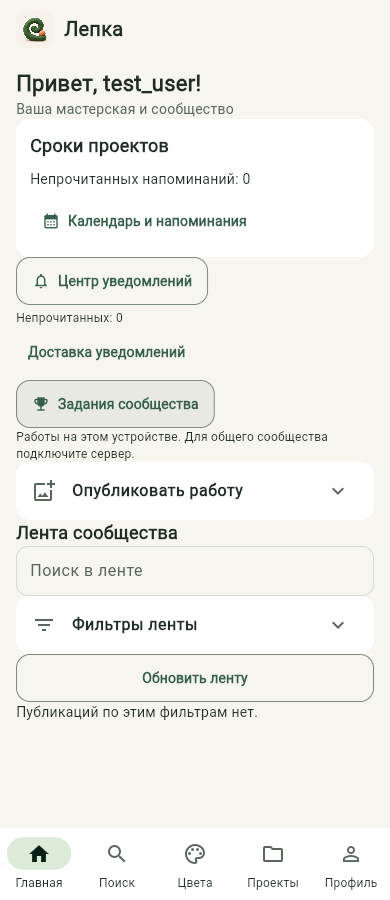
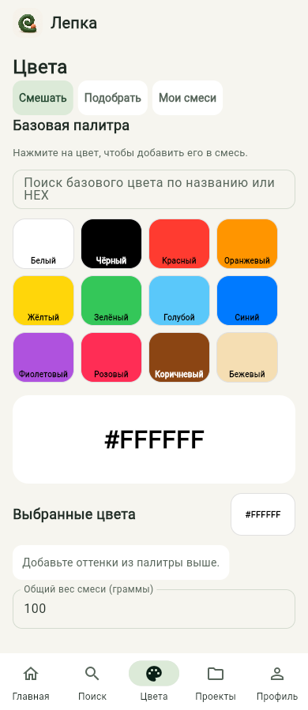
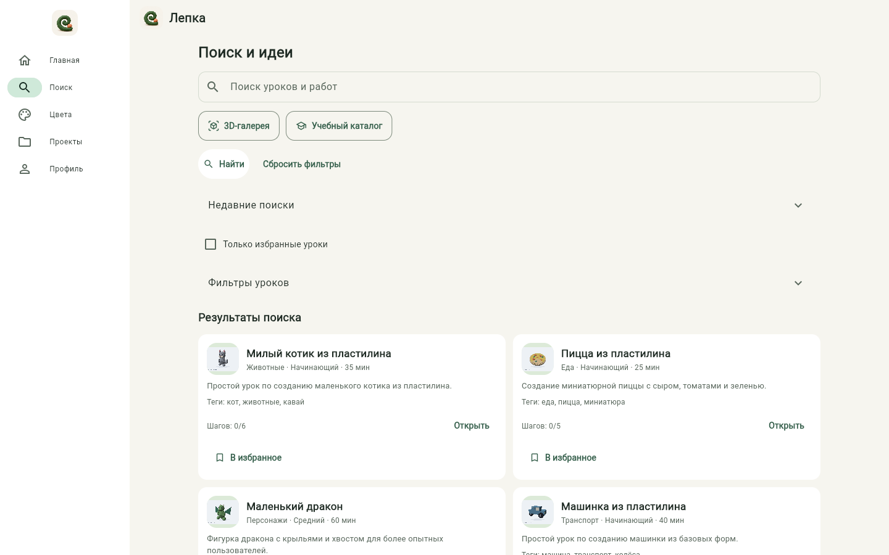
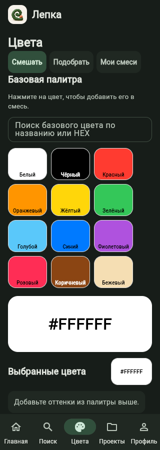
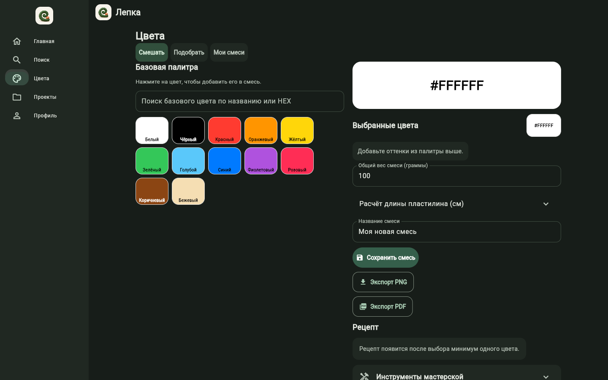
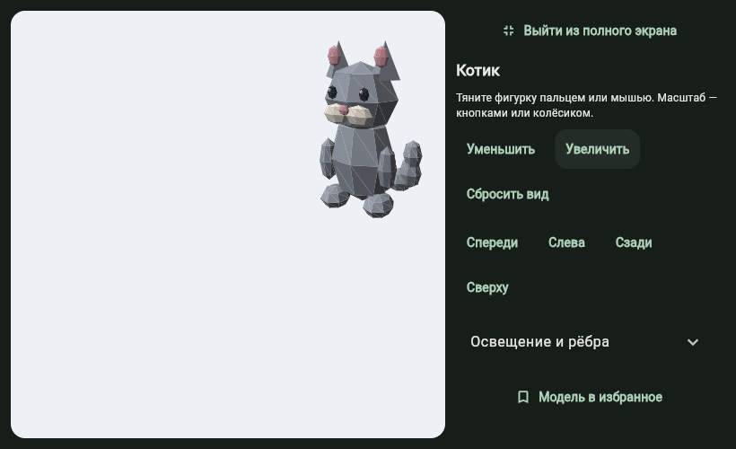

# Блок №29 — интерфейс мастерской

Обновление 0.13.0. Требования пользователя: спокойный современный стиль, меньше перегрузки, единая иерархия, удобные действия и адаптация без потери функций.

- Общая светлая и тёмная Material 3 тема: тёплый фон, зелёный основной и терракотовый дополнительный акцент, плоские карточки, поля и кнопки с едиными скруглениями. Второстепенный текст использует цвет текущей темы.
- Собственная иконка из пластилиновой спирали и шарика: `assets/icon.png`. Используется в оболочке, входе, заставке и Android launcher/adaptive icon; исходное изображение создано инструментом генерации изображений для этого приложения.
- Пять основных направлений сохранены. До 760 px — нижняя навигация, от 760 — компактная боковая, от 1180 — боковая с подписями. Содержимое ограничено по ширине для чтения на ПК. Окно ПК можно менять по размеру.
- «Цвета»: отдельные задачи «Смешать», «Подобрать», «Мои смеси». Поля и выбранные цвета сохраняются при переключении этих задач. На широком экране палитра и расчёт расположены рядом. Палитра переносится по строкам без скрытого вертикального скролла; камера, длина, PNG/PDF, калькулятор и таймер сохранены.
- «Проекты»: создание открывается отдельной сворачиваемой формой, обзор/статистика/перенос — отдельной группой. Основной список и этапы остаются доступны.
- Главная: создание публикации и фильтры ленты сворачиваются. Убрана декоративная карточка с одной и той же идеей. Уведомления, задания, календарь, публикации и комментарии сохранены.
- Профиль: «Мастерская» и «Настройки». Редактирование, безопасность, данные и удаление разделены на группы; опасное действие явно подписано. Смена темы продолжает применяться сразу после сохранения.
- Поиск: переходы к каталогу и 3D сгруппированы, результаты располагаются в две колонки на широком экране. В 3D-галерее — до трёх колонок. Вторичные списки ограничены по ширине; полноэкранный просмотр модели сохраняет собственную компоновку.

Изменение размеров меняет компоновку существующих контролов, не пересоздаёт форму и не сбрасывает несохранённый ввод. Сворачиваемые группы сохраняют состояние. Основные кнопки имеют минимальный размер 48 px, текстовые — 44 px. Реальные цвета пластилина, фотографий и 3D-сцены не перекрашиваются темой.

Проверки: 465 автоматических тестов прошли. Новые регрессии проверяют сохранение черновика при смене ширины/вида навигации, выбор задачи без сброса смеси, доступность настроек и удаления, ширину вторичных экранов и контраст текста/подписей палитры (не ниже 4,5:1). В браузере проверены пять разделов при 320/390/820/1440 px, сохранение смеси, PNG с содержимым, создание проекта, смена темы без перезапуска и 3D-просмотр. Снимки итоговой компоновки добавлены в папку screenshots. Проверка на физическом Android остаётся отдельной частью финального блока №30. Полное соответствие всем пунктам ТЗ не объявляется: известные ограничения перечислены в `remaining_work.md`.

## Снимки интерфейса

## Android 0.13.0

[Скачать APK](https://github.com/Gr1zle/lepka_helper/raw/refs/heads/artifacts/android-demo-20261031/lepka-helper-0.13.0-design-arm64.apk) · [PR №29](https://github.com/Gr1zle/lepka_helper/pull/29).

Android 9+, ARM64, package `ru.gr1zle.lepka_helper`, versionCode 2010. Установка поверх предыдущей версии без удаления приложения; сертификат SHA-256 совпадает с предыдущими сборками: `6428780dae2dc54778a9dd90eb4a52324b556b63fbdc3bd438784c4b5a0c8c2a`. Сервер Wi-Fi предыдущей версии совместим, обновлять его ради оформления не требуется.

SHA-256 APK: `a221fa846e3160bb129479c060ba125e2ddd6b2fbb52b025248e4badccce4bab`.

Проверены ZIP, байтовое совпадение всех поставляемых модулей/экранов/ресурсов с исходниками, отсутствие баз/сессий/ключей в приложении, подпись, версия, архитектура и Android FileProvider. Пиксели десяти PNG-ресурсов launcher/adaptive icon внутри самого APK совпали с генерацией из новой иконки; проверка не ограничилась файлом исходника. Полноэкранный 3D дополнительно проверен в браузере при 820×500. Исходный CI: [41489910698](https://github.com/Gr1zle/lepka_helper/actions/runs/41489910698), 465 тестов; после добавления снимков и обновления списков поставки отдельно прошли 6 серверных и 12 контрольных проверок. Физический Android здесь недоступен: камера, системный выбор папки и поведение клавиатуры/жестов требуют проверки на планшете.
