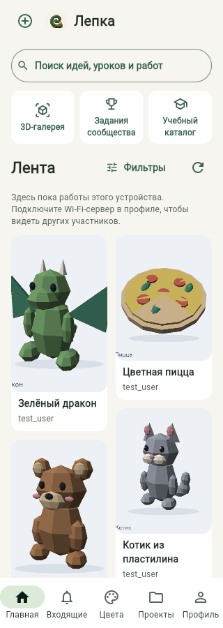
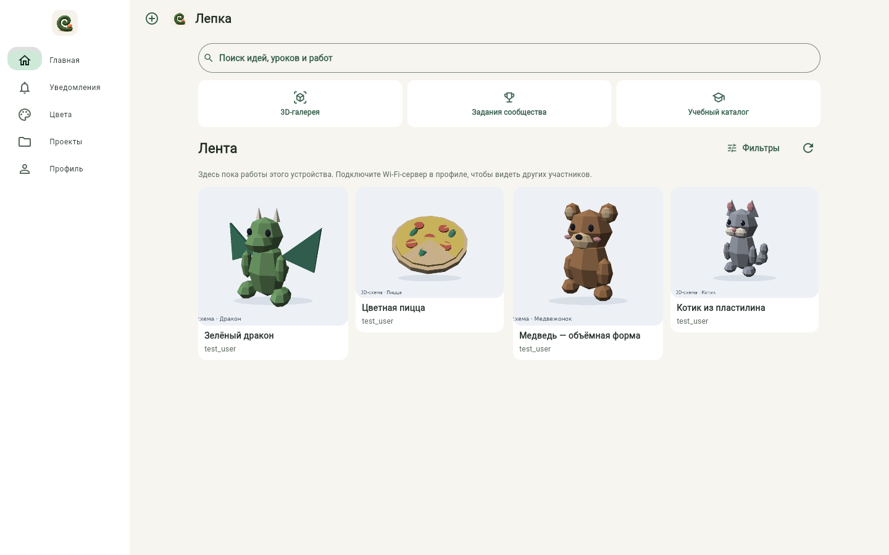
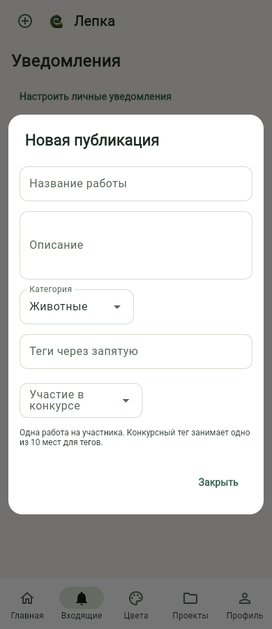
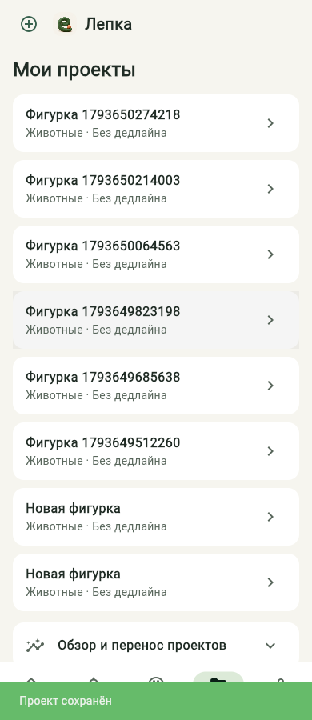
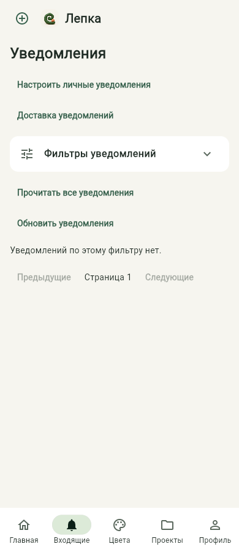
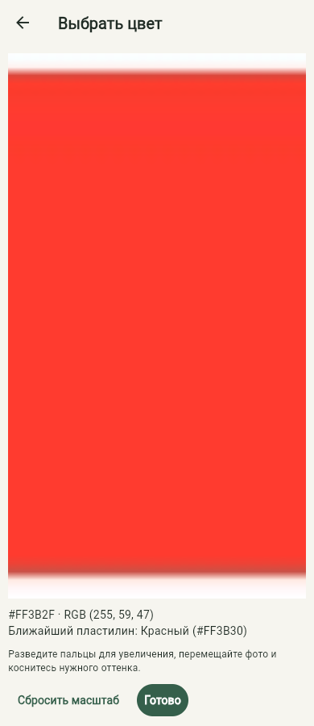

# Блок №30: новая навигация, лента и отдельные формы

Запрос пользователя после проверки №29: убрать отдельную вкладку поиска, сделать главную лентой изображений, вынести уведомления отдельно, иметь общую кнопку создания, показывать проекты кратко и выбирать цвет по увеличенному фото. Английский интерфейс и общее сообщество обязательны; прежняя трактовка английского как необязательного больше не применяется.

## Изменения 0.14.0

- Главная: поиск сверху, ссылки на 3D-галерею, задания и учебный каталог; ниже — лента обложек в колонках с разной высотой карточек. Нет приветствия, сроков проектов, центра уведомлений, доставки и встроенной формы публикации. Фильтры ленты сохранены.
- Поиск открывается отдельной страницей с историей, фильтрами, сбросом и генератором идей. При первом открытии результаты не загружаются автоматически. Можно нажать «Найти» с пустым запросом или выбрать только фильтры. Встроенные уроки доступны в поиске и через сохранённые переходы к материалам.
- Карточка работы открывает страницу с фотографиями, лайками, комментариями, жалобой и опубликованным проектом. Комментарии не запрашиваются для всех карточек ленты; для удалённых обложек используется существующий thumbnail API.
- В Android лента обновляется жестом от верхнего края списка: потянуть список вниз и отпустить. Это стандартное направление pull-to-refresh; свайп вверх прокручивает ленту. На ПК/в браузере предусмотрен небольшой значок обновления в заголовке вместо большой кнопки в содержимом.
- Общая кнопка «Создать» слева в верхней панели открывает выбор поста/проекта из любой вкладки. Формы — отдельные модальные окна с прокруткой. Черновики постов, фотографии и публикация в задание сохранены. После сохранения нового проекта открывается его список.
- «Проекты»: на карточке только название, категория и дедлайн. Содержимое конкретного проекта открывается в отдельном окне. Этапы и их фото не строятся для всех карточек списка. Изменение этапа обновляет открытый проект. Обзор/статистика/перенос расположены после списка, вне этапов.
- Уведомления — отдельная вкладка со списком, фильтрами, прочтением и настройками доставки/личных уведомлений.
- Убран поиск среди 12 базовых цветов. Сохранение новой смеси с тем же названием, результатом HEX и весом запрещено; сравнение названия учитывает регистр и лишние пробелы, веса — нормализацию до сотых. Проверка транзакционная, относится только к своему аккаунту. Старые записи не удаляются.
- В выборе цвета есть полноэкранное фото: приближение до 10×, панорамирование, сброс масштаба, выбор оттенка и возврат в исходный диалог. Координаты касания вычисляются внутри преобразованного изображения. Фото/сэмпл не теряются при возврате.

## Следующие две крупные группы

31. Проекты и этапы: название и необязательное описание, маленькая кнопка фото у действий, фото необязательно для личных этапов и обязательно при публикации, отдельное завершение проекта с финальным фото, исправление/приёмка перетаскивания и защита удаления, обновление снимков/экспорта/переноса после изменения схемы.

32. Обязательный английский интерфейс и приёмка общего сообщества: выбор языка, перевод интерфейса и сообщений, проверка двух аккаунтов/устройств через общий Wi-Fi-сервер, затем Android-приёмка и документы. При оценке три крупных блока считаются от начала этой переделки; это оценка, а не гарантия отсутствия дополнительных исправлений после проверки устройства.

Проверка реального перетаскивания этапов пока не объявляется завершённой. Запрет фото для завершения личного этапа в этой версии ещё остаётся прежним: изменение правила относится к №31. Сервер Wi-Fi уже реализован, но обязательная общая лента и взаимодействие двух пользователей должны пройти итоговую приёмку. Наличие английского не объявляется до реализации №32.

## Проверки

475 тестов прошли. Новые сценарии: навигация без вкладки поиска, отдельный inbox, пустой/фильтровый поиск, встроенный каталог без запросов публикаций, модальное создание из другого раздела, компактный список и обновление открытого проекта, отложенная загрузка комментариев, запрет дублей (включая одновременные сохранения), протокол подтверждения refresh и сохранение сэмпла при возврате из увеличенного фото. Обновлены регрессии старых переходов к урокам: логический поиск теперь относится к главной, а не к отдельной кнопке навигации.

Браузер: лента при 320/390/820/1440 px, открытие встроенного каталога, пустая страница поиска и явный запуск поиска, открытие карточки, отправка уникального комментария с проверкой записи в тестовой БД, глобальное создание проекта, список и окно проекта, отдельные уведомления, форма публикации, загрузка фото, полноэкранный выбор, приближение и возврат с применением HEX. Серые блоки из-за обязательного параметра Semantics в Flet 0.28 устранены; переход к фото ждёт подтверждения закрытия диалога, чтобы Flet не закрыл новую страницу повторным pop.

Нативный pull-to-refresh добавлен через существующее расширение Flet: один владелец прокрутки, обычная физика жеста, индикатор ждёт подтверждения Python или завершает ожидание по таймауту. Проверка на физическом Android, особенно жест обновления, pinch-to-zoom и системная кнопка «Назад», остаётся обязательной. Наличие Flutter-контрола и тестов не объявляется проверкой реального устройства.

## APK 0.14.0

[Скачать APK](https://github.com/Gr1zle/lepka_helper/raw/refs/heads/artifacts/android-demo-20261031/lepka-helper-0.14.0-discovery-arm64.apk) · [PR №30](https://github.com/Gr1zle/lepka_helper/pull/30) · [CI исходного коммита](https://github.com/Gr1zle/lepka_helper/actions/runs/41517191916).

Android 9+, ARM64, package `ru.gr1zle.lepka_helper`, versionCode 2011. Устанавливать поверх предыдущей версии без удаления приложения. Сертификат прежний: `6428780dae2dc54778a9dd90eb4a52324b556b63fbdc3bd438784c4b5a0c8c2a`. Текущий Wi-Fi-сервер совместим, обязательного обновления сервера для этого блока нет.

SHA-256 APK: `767e89e6e132c31164382073936d8f76b529bf09ca4d1b487e36c995fa405f76`. Проверены целостность архива, точное совпадение всех упакованных Python-модулей/экранов/ресурсов с исходниками, отсутствие баз/ключей/сессий, Android-версия/архитектура и подпись. В скомпилированной Dart-библиотеке проверены маркеры нового refresh-контрола, подтверждения и прежнего защищённого моста. Это проверка состава APK, а не приёмка жеста на физическом устройстве.

Проверять на планшете: установку поверх 0.13, новую главную/карточки, поиск без запроса с фильтрами, создание из разных вкладок, списки/окна проектов, увеличенное фото с pinch и возвратом, обновление ленты жестом вниз от её верхней границы, системный «Назад». Новые правила фотографий, завершение и исправление порядка этапов относятся к №31; английский и двухпользовательская приёмка — к №32.
