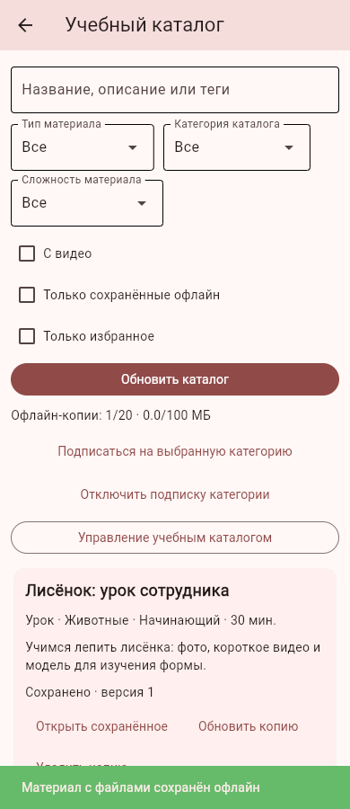
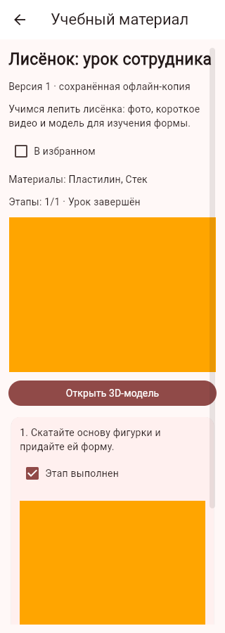
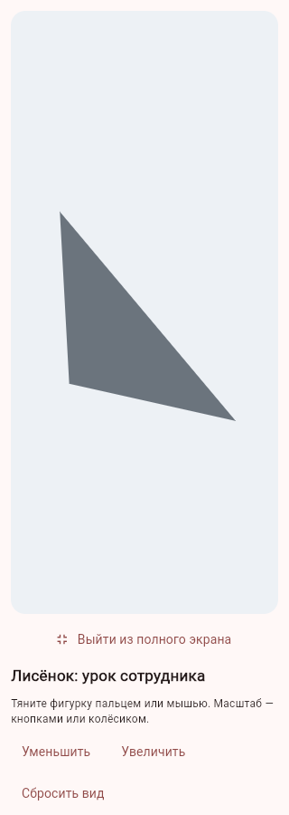

# Блок №27 — редактируемый учебный каталог

02.11.2026. Дополнительные уроки и модели размещаются на выбранном Wi-Fi-сервере. Встроенные уроки и модели остаются доступны в прежних разделах; исходное ТЗ и исторический Plan не изменяются.

## Работа пользователя

Поиск → «Учебный каталог». Фильтры по названию/описанию/тегам, категории, сложности, типу, наличию видео, сохранённым копиям и избранному. Перед открытием скачивается полный материал со всеми файлами. До 20 материалов и 100 МБ на аккаунт/сервер; неполная загрузка, нехватка места или изменение серверной версии не заменяют прежнюю копию. Автоматически загружается только лёгкий список, не видео и модели.

Сохранённый урок включает чек-лист этапов, фото, видео, личную заметку и избранное. При новой редакции этапы отмечаются заново, заметка/избранное сохраняются; прежняя версия остаётся рабочей до явного обновления. Модели открываются в прежнем 3D-просмотре с вращением, масштабом, освещением и полноэкранным режимом. Копия каталога не занимает квоту личных импортированных моделей.

MP4: рекомендуется H.264/AAC, максимум 12 МБ. Android использует flet-video 0.1.1; веб открывает видео в отдельной вкладке штатного браузерного плеера через ограниченный по сроку приватный адрес с поддержкой byte ranges, ПК — через системный плеер. Кодеки не перекодируются; совместимость зависит от устройства. Срок веб-адреса — 10 минут, после него открыть видео заново. Фото JPG/PNG/WebP до 10 МБ очищаются от EXIF и нормализуются. OBJ либо ZIP с OBJ/MTL — до 3 МБ, текстуры не поддерживаются.

## Работа сотрудника

Панель администратора → «Учебный каталог» или кнопка в каталоге. Отдельное право `catalog.manage` можно выдать преподавателю без доступа к аккаунтам, жалобам и ролям. Сервер проверяет его заново на каждом административном запросе.

Редактор: название, описание, категория, сложность, время, теги, список материалов/инструментов; до 20 этапов с перестановкой, фото и MP4. Обложка и OBJ/MTL необязательны для урока, для 3D-материала нужна модель. Есть черновик, публикация и архивирование. Даже черновик проходит проверку целостности полей. Причина изменения записывается в журнал вместе с номером версии. Одновременное сохранение старой версии возвращает конфликт; сотрудник открывает актуальную версию вручную. История редакций/откат не добавлены.

До 200 материалов и 128 МБ учебных файлов на сервере. Файлы неизменяемы и проверяются по хешу. Черновики/неиспользуемые файлы доступны только сотруднику; обычному аккаунту выдаются только файлы опубликованных материалов. Архив скрывает материал на сервере, но не удаляет уже скачанные копии с отключённых устройств. Очистка удаляет только файлы без ссылок из сохранённых документов; перед очисткой сотрудники должны сохранить открытые редакторы.

Статистика показывает уникальных читателей и завершивших урок, с защитой от повторной доставки. Это пользовательские отметки, а не доказательство качества лепки. Локальный прогресс работает без сервера; после связи отправляется текущая редакция. Старая версия не приписывается новой. Статистика встроенных демонстрационных уроков этим блоком не преобразуется.

## Обновления и ограничения

Подписка на категорию создаёт in-app событие о новом материале/версии при последующем обновлении списка. В открытом приложении при доступном API список и отложенная статистика сверяются раз в минуту после первого использования каталога. Автозагрузки тяжёлого медиа нет. Доставка Android использует механизм №26 при работающем приложении; удалённого FCM при закрытом телефоне по-прежнему нет.

Новый кеш, подписки, заметки и прогресс каталога хранятся на устройстве и не входят в личный снимок №24. Это отдельное ограничение переноса; аккаунт/API разделены. Полная серверная резервная копия сохраняет учебные документы и файлы. Удаление офлайн-копии сохраняет заметку и отметки; при удалении аккаунта связанные строки SQLite удаляются каскадно. Временная файловая копия MP4 для системного плеера не является резервной копией.

## Проверки и поставка

Проверяются настоящий FastAPI, роли/публикация/архив, доступ к файлам черновика, конфликты 409, откат при сбое журнала, кеш/контрольные суммы/квоты, прерванное скачивание, разные идентификаторы клиента и сервера, прогресс/статистика, подписки и существующий 3D-рендерер. Редактор и чек-лист проходят проверку настоящими Flet-контролами. Физический Android и кодеки видео нужно проверить на устройстве.

Браузер: настоящий сервер и отдельная клиентская база, серверный пользователь 1 соответствует локальному 3. Полный урок с фото, настоящим MP4 (сгенерированным ffmpeg) и OBJ скачан; чек-лист сохранён, видео открылось штатным плеером браузера. После остановки API сохранённый урок и полноэкранный 3D работали на ширине 320 px. Ошибок JS нет, внешние ключи чистые. В серверной статистике один читатель/завершивший, повторный просмотр не дублирует пользователя. Все данные синтетические.

Итоговый локальный прогон: **447 тестов прошли**. Отдельно повторены пять проверок подготовки Android-пакета после подключения видеомодуля. Нативный модуль защищённого входа/уведомлений упакован стандартным Flet extension wheel с версией по хешу исходников, чтобы он сохранялся при полной переустановке зависимостей. Версии media_kit 1.1.11, media_kit_video 1.2.5, media_kit_libs_video 1.0.4 и media_kit_libs_android_video 1.3.6 закреплены для Flutter 3.29 / Android SDK 35. Ключи, базы и конфигурация владельца в пакеты сборки не копируются.
