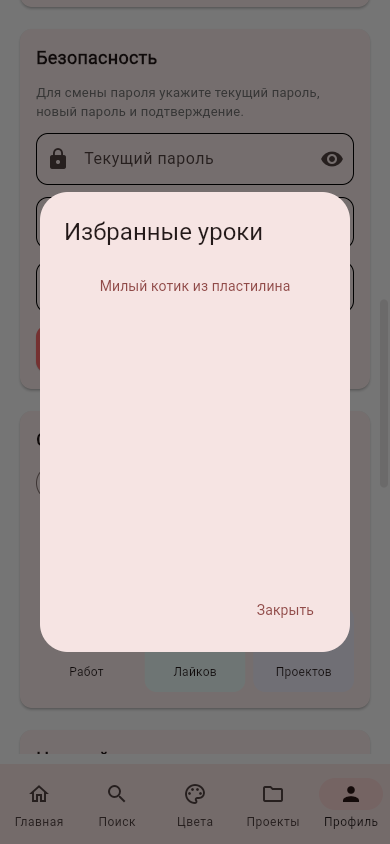
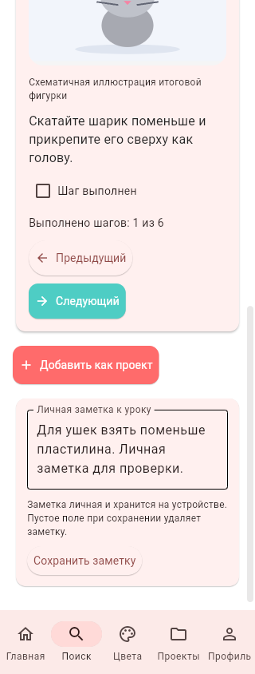
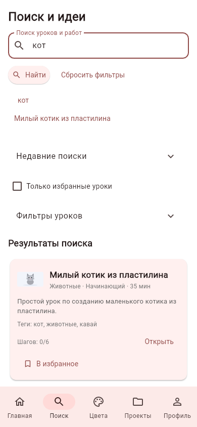
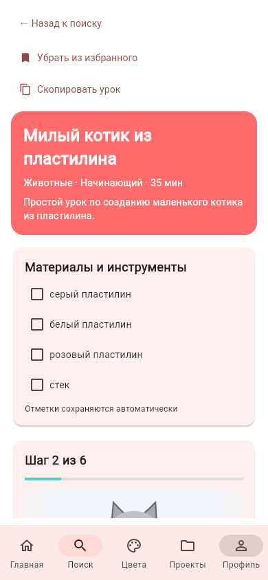

# Личная библиотека уроков и поиск

Следующий крупный блок после проектов и инструментов. Исходное ТЗ не изменялось.
APK на этом этапе не собиралась, разработка и проверки ведутся через GitHub.

## Избранное и продолжение

У встроенных уроков есть «В избранное» / «Убрать из избранного» в карточке
поиска и на экране урока. В профиле доступны «Избранные уроки» и «Продолжить
уроки». Выбор открывает урок на вкладке поиска с последним сохранённым шагом,
материалами, отметками и личной заметкой. Завершённые уроки не входят в список
продолжения; их можно открыть из поиска или избранного.

Внутренние переходы переключают содержимое вкладки напрямую: повторное событие
того же адреса `/home` в Flet не требуется. Возврат к поиску строит свежие
элементы из сохранённого состояния. Запрос и фильтры остаются при возвращении
из урока и переходе между вкладками в текущей сессии.

## Личные заметки и копирование

Внизу урока — поле до 2000 символов и «Сохранить заметку». Пустое сохранённое
поле удаляет заметку. Черновик остаётся при смене шага в текущем уроке; переход
в другой раздел без сохранения не записывает его автоматически. Поздние события
от заменённого поля не должны стирать актуальный черновик.

«Скопировать урок» передаёт в буфер заголовок, описание, материалы и шаги
встроенного урока. Личная заметка, прогресс, ID пользователя и токен в этот текст
не входят. Это текст для вставки в сообщение, не публичная ссылка и не системное
окно отправки. Копирование зависит от разрешений браузера/ОС на буфер обмена.

## Поиск

- Пустой запрос показывает каталог с выбранными фильтрами. Для непустого запроса
  требуется от 2 до 120 символов. Материалы и текст урока участвуют в поиске;
  «е» и «ё» сопоставляются при поиске встроенных уроков.
- Подсказки: до 10 уникальных совпадений из названий, тегов, материалов и личной
  истории. Ввод по буквам не записывает историю. Выбор подсказки выполняет поиск.
- «Найти» или Enter записывает подтверждённый запрос: до 20 недавних, новые
  сверху; повторные запросы без учёта регистра и лишних пробелов поднимаются
  наверх. Очистка требует подтверждения и затрагивает только текущего владельца.
- Дополнительно к категории, сложности, времени и видео: только избранные,
  начатые, встроенные уроки. Сортировка встроенных уроков — релевантность,
  время или название. Сортировка работ сообщества по популярности/новизне здесь
  не добавлялась.
- Результаты размещены перед генератором идей; фильтры и генератор раскрываются
  отдельно. «Сбросить фильтры» возвращает полный каталог, история сохраняется.
- На карточке встроенного урока показан реальный личный прогресс вместо прежних
  демонстрационных счётчиков просмотров и лайков.

Фильтры встроенных/избранных/начатых уроков не запрашивают сообщество. Если после
проверки сессии загрузка сообщества завершилась сетевой ошибкой, встроенные уроки
сохраняются на экране вместе с сообщением и повторной попыткой. Проверка серверной
сессии остаётся обязательной для личных действий: скрытого местного входа при
сбое сервера и полноценной оффлайн-очереди в этом блоке нет.

## Данные и границы

Новые клиентские таблицы: `lessonFavorites`, `lessonNotes`, `searchHistory`.
Все привязаны к местному владельцу; миграция не меняет прежний `lessonProgress`.
Повторное добавление в избранное не создаёт дубликатов, история ограничивается
транзакционно. Удаление аккаунта очищает эти данные, не затрагивая других
пользователей. Это очистка библиотеки текущего клиента, а не дистанционная очистка
других устройств. Старый обработчик после выхода/смены сессии не записывает данные.

Даже в режиме API это местная библиотека: используется уже существующая
привязка серверного аккаунта к отдельному локальному ID. Синхронизации избранного,
заметок, истории и встроенного прогресса между устройствами пока нет.

Библиотека охватывает шесть существующих встроенных уроков. Их SVG остаются
схематичными иллюстрациями; фотографии/видео этапов, 3D-модели и избранное моделей
этим блоком не реализованы. Следующий большой этап — 3D и учебные медиаматериалы.
Редизайн остаётся отдельным завершающим этапом.

## Проверки

Полный набор локально: 269 тестов, OK. Дополнены проверки изоляции владельцев,
блокировки, миграции, длины/удаления заметки, удаления аккаунта, предела истории,
подсказок без записи по буквам, сортировки, личного прогресса, скрытых полей,
черновика после смены шага, копирования без личных данных и внутренних переходов.

В настоящем Chromium при ширине 390/320: поиск, подсказки, избранное, сохранение
заметки, возврат к поиску, переход из профиля, продолжение со второго шага и
вход вторым аккаунтом. Буфер обмена прочитан с разрешением браузера: содержит
текст урока, не содержит личную заметку. SQLite отдельно подтвердила точный текст
заметки, единственное избранное, историю, последний шаг и отсутствие этих данных
у второго владельца. Ошибок страницы не обнаружено. Все данные синтетические.
Публичные ресурсы Flutter загружались через APIRequestContext с проверкой TLS.

