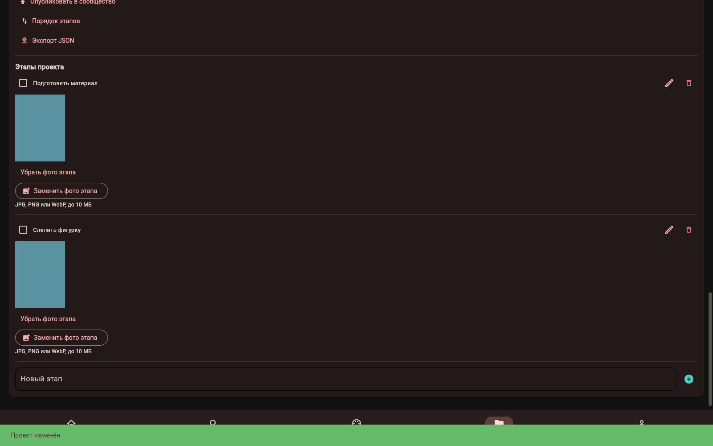
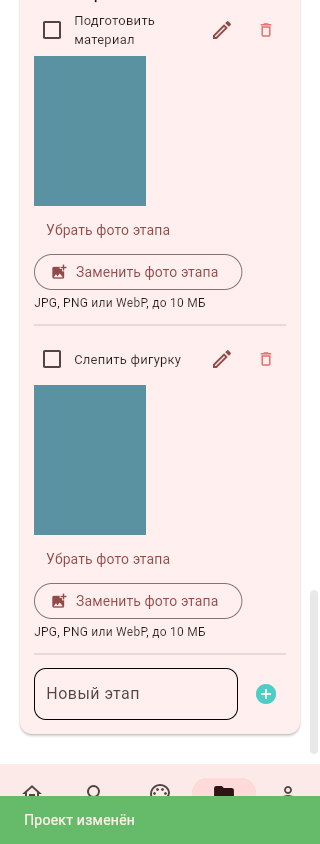
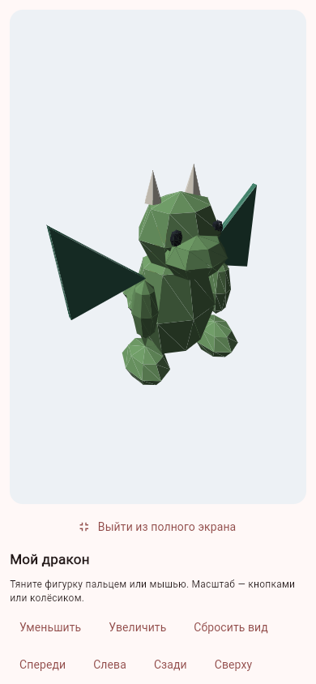
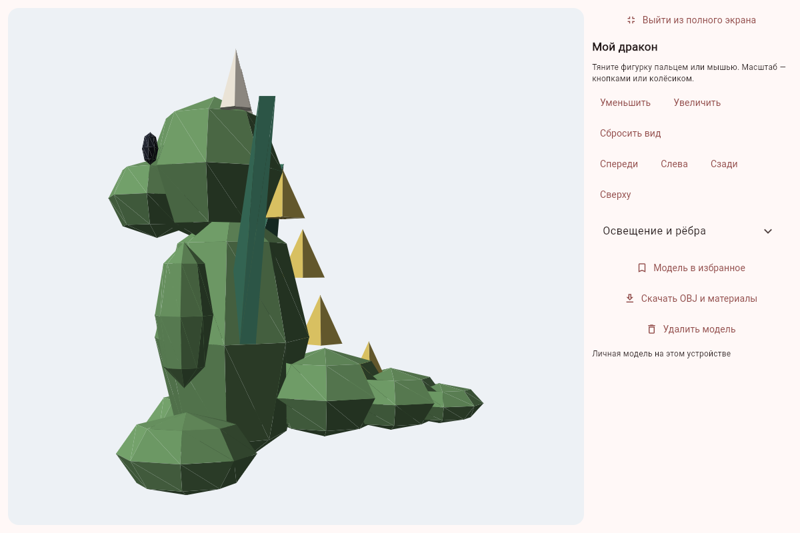
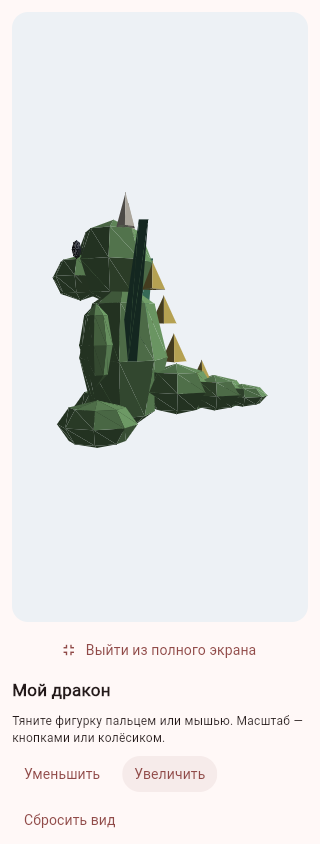
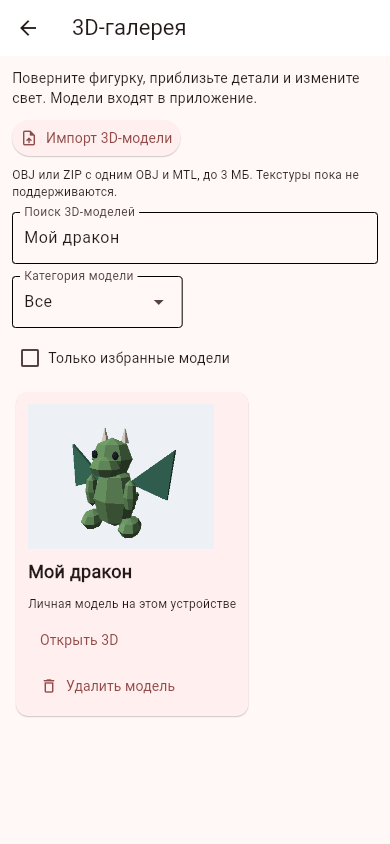

# Исправление проектов, импорт моделей и полноэкранный просмотр

Ветка `feature/model-import-fullscreen`, поверх календаря и напоминаний #15. Исходное ТЗ и исторический план не изменены. Новый APK в этом пакете не собирается.

## Серый блок после изменения проекта

Дефект воспроизведён в Chromium: два синтетических проекта с двумя этапами и фото, тёмная тема, повторное добавление/изменение дедлайна. После сохранения появлялась длинная серая область, конец списка скрывался далеко за ней.

При обновлении списка код очищал живой `Column`, а обновление статистики в это время вызывало `page.update()`. Клиент получал промежуточное дерево без проектов, затем вновь большой список переменной высоты. Дополнительно использовалась ленивая компоновка верхнего `ListView`. Теперь статистика при сборке не отправляет экран, новые карточки собираются отдельно и заменяют список целиком, верхний список строится без ленивых заполнителей. Фото, этапы и дедлайны сохраняются как прежде.

Регрессионная проверка следит за каждым обновлением страницы во время трёх сохранений: существующий проект не исчезает из живого дерева. Браузерная проверка повторяет сохранение трижды и проверяет, что в конце прокрутки виден последний ввод «Новый этап» вместо пустого блока. Пользовательская база не используется.

## Импорт и личная библиотека

«Поиск» → «3D-галерея» → «Импорт 3D-модели». Можно выбрать одиночный `.obj` или `.zip`, содержащий ровно один OBJ и не больше одного MTL. ZIP удобен для переноса геометрии и её цветов вместе; встроенная кнопка экспорта готовит подходящий образец. Перед сохранением можно изменить название, видно число треугольников. Импорт добавляет личную копию.

Личные модели доступны в галерее, категории «Мои модели» и общем поиске, поддерживают избранное и удаление с подтверждением. При фильтре сложности/времени урока импортированные модели не показываются, поскольку у них нет связанного урока. Геометрия, цвета и PNG-превью хранятся в новой `importedModels` в SQLite устройства; после нового входа модель остаётся доступной своему владельцу. Даже в режиме API импортированные модели не публикуются и не синхронизируются. Удаление аккаунта удаляет модели, удаление модели — её отметку избранного.

Поддерживается геометрический OBJ-поднабор: вершины, треугольники и простые многоугольники до восьми вершин с разбиением на треугольники; отрицательные индексы; однотонные цвета `newmtl`/`Kd` из MTL. Текстуры, анимация, glTF/GLB/USDZ/STL не реализованы. Внешние файлы материалов и изображения с диска или по URL не читаются. Одиночный OBJ без MTL показывается базовым цветом. На сложных пересекающихся поверхностях остаются ограничения программной сортировки треугольников по глубине.

Ограничения: выбранный файл до 3 МБ, OBJ до 2 МБ, MTL до 100 КБ, до 6000 вершин, до 3000 ненулевых треугольников и 20 моделей на владельца. При превышении предлагается упростить модель или удалить ненужные. ZIP не распаковывается на диск: разрешены только OBJ/MTL и текстовые описания, максимум восемь элементов и ограниченный суммарный распакованный размер. Отсекаются переходы `..`, абсолютные пути, повторные имена, ссылки и шифрованные файлы. Тексты должны быть UTF-8.

На ПК/Android используется системный выбор файла. В web файл передаётся по ограниченной одноразовой ссылке, проверяющей сессию. Ошибочный, слишком большой или отменённый файл не сохраняется. Экспорт личной модели в браузере также требует действующей сессии; личные OBJ не помещаются в публичные assets или контрольный архив. Системный экспорт ZIP на Android пока скрыт, как и прежде.

## Полноэкранный режим

«Во весь экран» разворачивает просмотр внутри приложения: скрывает заголовок и увеличивает область модели. На широком экране инструменты справа, на узком — снизу в прокручиваемой панели. Доступны те же ракурсы, масштаб, сброс, свет, рёбра, избранное и экспорт; у импортированной модели — удаление, у встроенной — связанный урок. При выходе и смене размеров сохраняются камера, свет и состояние рёбер. Геометрия и Canvas переиспользуются.

Кнопка «Выйти из полного экрана» возвращает обычный просмотр. Системное событие «Назад» сначала закрывает полный экран; следующее возвращает к галерее/уроку. Это режим внутри Flet, а не включение F11 у браузера. Физический Android и системный выбор файла на нём в этом пакете ещё не проверялись.

## Проверки

300 тестов на временных данных: прежний набор приложения, воспроизводимая регрессия обновления списка проектов, сохранение камеры и Canvas, нативный импорт с предварительным просмотром, повторное сохранение, приватность, отрицательные сценарии OBJ/ZIP, квота моделей, блокировка/удаление владельца и одноразовые HTTP-загрузки/скачивания с отзывом сессии.

Браузерные сценарии используют отдельные синтетические данные и настоящий Flet-сервер. Повторное редактирование пройдено трижды на тёмном экране 1600×1000 и трижды на светлом 320×844; последняя строка проекта доступна в конце прокрутки без серого заполнителя. Реальная браузерная загрузка ZIP с OBJ/MTL, предварительный просмотр, вращение, полноэкранные инструменты, свет, избранное, скачивание, выход из полного экрана, новая браузерная сессия с сохранённой библиотекой и подтверждённое удаление также прошли. JavaScript-ошибок нет. Снимки ниже показывают результат исправления, импортированную модель и компоновку инструментов. Android-комплект и контрольный ZIP включают новые модули и проверки по явному списку.

