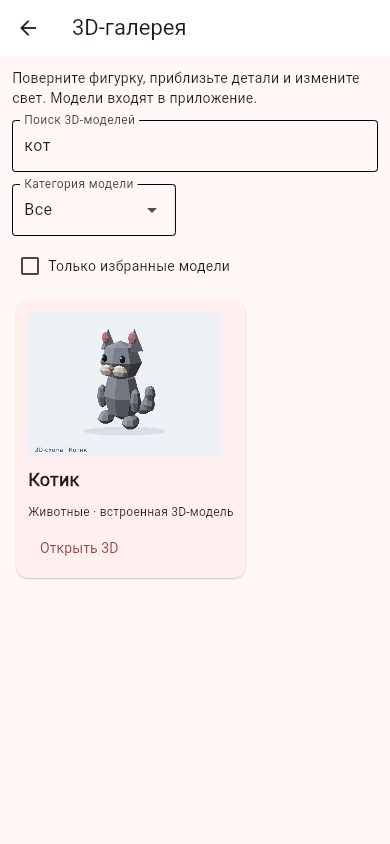
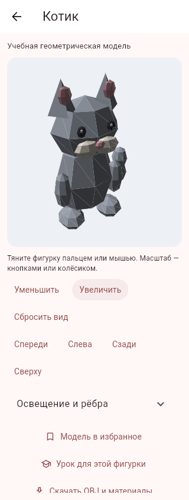
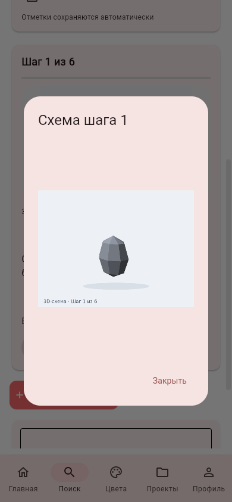
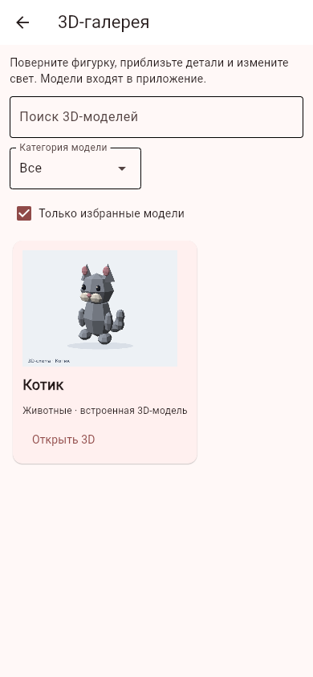

# Офлайн-модели и схемы уроков

Дата проверки: 31.10.2026, московское время. Ветка `feature/offline-models-learning-media`, поверх библиотеки уроков `feature/lesson-library-search`. Версия APK остаётся 0.6.1: новый APK в этом блоке не собирался.

## Что доступно

В «Поиске» появилась «3D-галерея»: шесть встроенных оригинальных фигурок — котик, пицца, дракон, машинка, аниме-персонаж и медвежонок. Галерея поддерживает поиск, категории и личное избранное. Результаты моделей также входят в общий поиск и его фильтры категории, сложности и времени связанного урока. История запросов и подсказки учитывают модели. В профиле есть переход к избранным моделям.

Просмотрщик использует настоящее треугольное OBJ-представление с цветами из MTL, а не смену плоских картинок. Модель вращается перетаскиванием, масштабируется кнопками или колесом. Есть четыре ракурса, сброс вида, направление и яркость света, отображение рёбер. Встроенный набор работает без сервера и внешних запросов. В браузере и настольной версии можно сохранить ZIP с OBJ, MTL и пояснением; на Android эта кнопка скрыта до реализации системного экспорта.

Шесть уроков получили 37 отдельных PNG-схем, по числу этапов: 6 + 5 + 7 + 6 + 7 + 6. Схема меняется вместе с шагом, открывается крупнее с увеличением и связывает урок с его моделью. Возврат из модели сохраняет выбранный этап и несохранённый черновик личной заметки. Черновик привязан к текущему аккаунту; переход назад заново проверяет пользователя.

## Данные и устройство

`modelFavorites` хранит отметки по пользователю в локальной SQLite, включая режим API. Повторное добавление безопасно, заблокированный аккаунт не может менять отметки, удаление аккаунта очищает их. Синхронизации избранного между устройствами нет. Геометрия общедоступна и не содержит личных данных.

`mesh_renderer.py` читает ограниченный OBJ/MTL, нормализует геометрию, выполняет поворот, перспективную проекцию, отсечение обратных граней, расчёт плоского освещения и сортировку треугольников по глубине. Flet Canvas рисует их средствами клиента. Формы Canvas переиспользуются при изменении ракурса. Зависимости приложения не расширены: WebView, CDN, JavaScript-библиотеки и сетевой 3D-сервис не нужны.

Каталог ограничивает имена файлов. Парсер проверяет конечность и диапазоны координат, индексы, цвета, размеры текста и число вершин/треугольников; внешние ссылки OBJ не загружаются. Пользовательского загрузчика произвольных моделей нет. Сортировка по глубине подходит этим простым непрозрачным моделям; она не заменяет универсальный GPU-рендер с буфером глубины и корректным пересечением любых поверхностей.

Ресурсы созданы `python -m scripts.generate_learning_models`. В комплекте около 1,7 МБ моделей, превью и схем. Манифесты подготовки Android и контрольного ZIP явно включают все шесть OBJ/MTL/превью и все 37 схем; личные базы и `.env` в поставку не входят.

## Проверка

- 279 автоматических тестов на временных данных: парсер, проекция и свет, каталог и ZIP, приватность/блокировка/удаление избранного, UI-управление, смена схем, возврат к уроку с черновиком, миграции и остальные функции приложения.
- Chromium + настоящий Flet-сервер: вход, поиск котика, открытие модели, перетаскивание с изменением изображения, масштаб, свет, ширина 320 пикселей, избранное, скачивание ZIP, переход к уроку, увеличение схемы, следующий шаг, возврат через модель, избранное в профиле. Ошибок JavaScript нет; схемы первого и второго шага возвращаются с HTTP 200.
- Около 3,2 мс на проекцию одного ракурса котика в Python на проверочной машине. Это не измерение полной отрисовки и не показатель скорости Android.
- Новый просмотрщик ещё не проверен на физическом Android. Скорость Canvas, жесты и системная кнопка «Назад» на планшете нужно проверить в следующем общем APK.

## Что остаётся открытым

Модели — упрощённые геометрические пособия, не сканы пластилиновых работ. Схемы показывают накопление деталей; часть завершающих этапов использует ту же геометрию с отдельной подписью. Это не фотографии рук или процесса лепки. Реальные пошаговые фотографии и видео, текстуры, glTF/USDZ, пользовательский импорт моделей, AR и push не реализованы. Исходное ТЗ и его срок не менялись.
