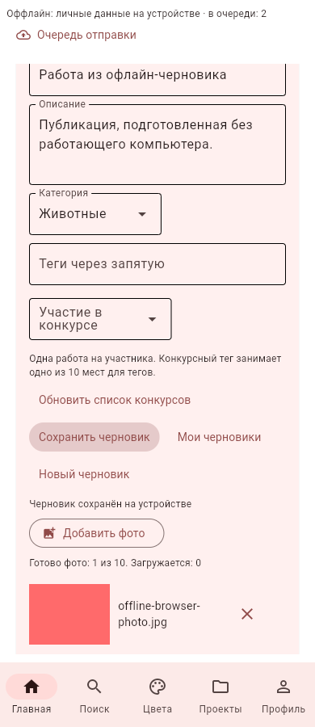
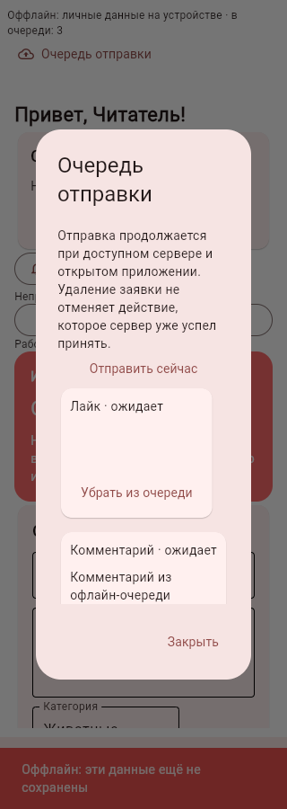
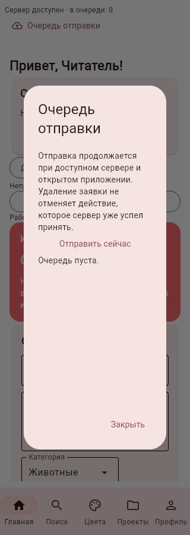

# Блок №25 — серверный вход, офлайн, черновики и очередь

02.11.2026. Продолжение №24. Серверные токены в APK сохраняются отдельным нативным модулем: AES-GCM, ключ Android Keystore, зашифрованная запись в закрытых SharedPreferences. В обычный JSON/SQLite/экспорт токен не попадает. Android Auto Backup отключён для приложения, чтобы не восстанавливать шифротекст без ключа; полные копии и Wi-Fi-перенос остаются доступны. Прежний местный Android-вход сохраняет прежний механизм проверки токена по локальной базе.

На Android есть переключатель запоминания входа. В браузере и на ПК серверный токен на диск не записывается. При выходе или смене сервера защищённый вход удаляется; локальная отметка выхода не допускает повторный автоматический вход даже при ошибке удаления защищённой записи.

Офлайн-доступ использует ранее подтверждённую сессию и её серверный срок (12 часов). Он открывает личные проекты/смеси/встроенные уроки/модели; не выдаёт административных прав и не превращается в вход по локальному паролю. Блокировку или отзыв токена без связи узнать нельзя: при восстановлении связи выполняется новая проверка /auth/me, HTTP 401 завершает вход и останавливает отправки. После истечения срока для нового входа нужен работающий сервер. Защищённое хранилище требует проверки на физическом Android; сборка и программные проверки не заменяют испытание Keystore устройства.

Текст и фотографии публикации сохраняются в черновик на устройстве; до десяти черновиков/64 МБ на владельца, с явным открытием/удалением/новым черновиком. Отправляемые публикации, лайки и комментарии сначала записываются в очередь без токенов. До 100 активных действий/64 МБ. Успешные записи сохраняют только краткий результат, тяжёлое тело очищается. Очередь разделена по локальному владельцу, серверному ID и адресу API, новая сессия другого аккаунта её не отправляет.

Пока приложение открыто, монитор проверяет сервер и повторяет действия. В закрытом приложении это не Android-служба и не фоновая push-доставка. При сетевой ошибке действие остаётся ожидающим, ошибки данных показываются как требующие исправления. Обычную публикацию с ошибкой можно вернуть в черновики. Публикация проекта с инструкцией сохраняется в очереди до исправления исходного проекта и явного удаления старой заявки. Удаление заявки не отменяет действие, которое сервер уже успел принять.

Публикации и комментарии имеют постоянный requestId; серверная квитанция предотвращает повторное создание после потери ответа. Лайк передаётся как желаемое состояние, не как повторное переключение. Запросы с тем же ID и другим содержимым отклоняются. Квитанции публикаций сохраняются после удаления самой работы, чтобы запоздалый повтор её не воссоздал. Лимит комментариев сохраняется, превышение возвращает 429 для позднего повтора.

Прочитанные страницы сообщества и фотографии кешируются отдельно для аккаунта/API (100 записей, до 32 МБ). При отсутствии кеша раздел сообщает об отсутствии данных; личные вкладки остаются доступны. Это не предварительное скачивание всего сообщества или новых учебных материалов: встроенные уроки уже поставляются с приложением, редактируемый серверный каталог относится к следующему блоку.

Черновики, очередь, кеш и защищённый вход не переносятся снимком №24. Черновики и очереди остаются на устройстве, где пользователь их создал. Для этого блока нужен обновлённый сервер с /community/actions и сроком сессии в ответах. Исходное ТЗ не менялось.

## Проверки

Полный набор — 418 тестов, включая монитор связи, палитру при остановленном настоящем API, восстановление текста/фото черновика и изоляцию сессий/очереди.

Браузерный сценарий с настоящим API: чтение ленты, выключение сервера, постановка лайка/комментария/публикации с фото, сохранение и повторное открытие черновика после смены вкладки, создание личного проекта без сервера. После повторного запуска того же API монитор автоматически отправил три действия. На сервере ровно один лайк, один комментарий и одна новая работа. В клиенте владелец 3 соответствует серверному владельцу 2; посторонние локальные владельцы не затронуты. Тяжёлые тела успешно отправленных записей очищены, внешние ключи проверены. Ошибок JS нет.

В процессе исправлены повторный запуск монитора после очистки сессии и несовместимый вызов SessionStorage.get, из-за которого после успешной доставки показывался ошибочный статус. Итоговая проверка показывает «Сервер доступен · в очереди: 0».

## Итог программной проверки

Полный локальный прогон: **418 тестов прошли**. Браузерная проверка повторена после исправления статуса; после доставки отображается «Сервер доступен · в очереди: 0». Дополнительно проверены монитор без повторного запуска после выхода, палитра с ранее подтверждённым входом при остановленном API и загрузка текста/фото черновика.

APK 0.9.0 собран для Android 9+, ARM64, versionCode 2006. Совпадение подписи с 0.8.0, целостность и актуальные исходники/учебные ресурсы проверены; личных баз/сессий/секретов внутри нет. Нативные исходники совпадают с подготовленным пакетом, Java-класс Keystore/AES-GCM присутствует в DEX, в итоговом манифесте allowBackup/fullBackupContent=false. SHA-256 APK: `8bf01dfee51a838359e4df4f330bff2ec7dd14330abc4800e4a7ca63d0f3b706`.

Физическая проверка: обновить сервер, установить APK поверх 0.8.0, войти с запоминанием, закрыть/открыть приложение; затем выключить сервер и проверить личные вкладки/черновик/очередь. Включить компьютер с прежней папкой данных и дождаться отправки. После выхода и смены сервера вход не должен восстанавливаться. Срок серверной сессии остаётся 12 часов; после него нужен новый вход с доступным сервером.

## Поставка

[APK 0.9.0](https://github.com/Gr1zle/lepka_helper/raw/refs/heads/artifacts/android-demo-20261031/lepka-helper-0.9.0-offline-arm64.apk) · [Сервер 0.9.0](https://github.com/Gr1zle/lepka_helper/raw/refs/heads/artifacts/android-demo-20261031/lepka-server-0.9.0.zip) · [PR №25](https://github.com/Gr1zle/lepka_helper/pull/25).

[GitHub Actions: 418 тестов прошли](https://github.com/Gr1zle/lepka_helper/actions/runs/41359072846). Исправление изоляции тестового окружения в 8ddcaa5 не меняет runtime 1f641c5, из которого собран APK. Артефакты опубликованы в отдельной ветке artifacts/android-demo-20261031, коммит e2d46cd.

Серверный ZIP: SHA-256 `e3b6f8c2d02270d62f524b11abe28361085a4c49cfa5833c7ad6f60f391b0b62`. Остановить старый процесс, распаковать новый сервер отдельно и использовать прежний --data-dir; не заменять и не удалять LepkaHelperServer/accounts.db. APK устанавливается поверх 0.8.0. После обновления один раз войти с запоминанием. Проверки и скриншоты выполнены на синтетических данных, пользовательские базы не изменялись.
