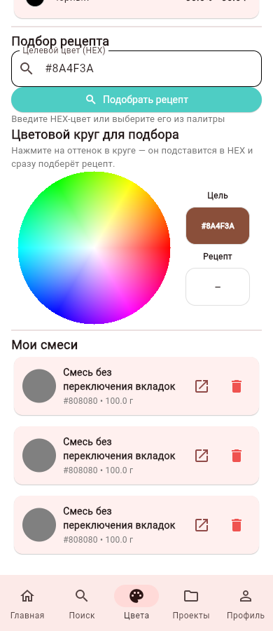
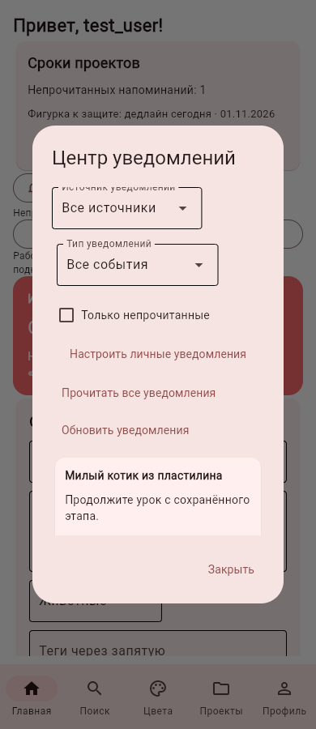
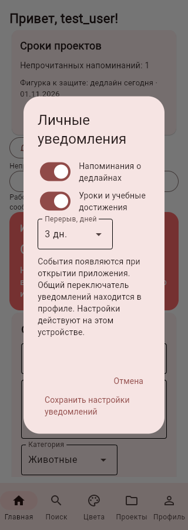

# Личный центр уведомлений и скорость вкладки «Цвета»

Блок №23, 01.11.2026. Продолжение Wi-Fi-подключения.

Цветовой круг заменён одним обработчиком координат вместо сотен невидимых элементов. Изображение кешируется между открытиями вкладки; вычислительный подбор рецепта запускается по запросу, без фонового прогрева при каждом открытии. Список сохранённых смесей обновляется новой коллекцией и явным обновлением страницы до сообщения об успехе. Для этого экрана отключено ленивое создание элементов списка, чтобы виджеты ниже экрана получали изменения без переключения вкладок. HTTP-соединения домашнего API переиспользуются в пределах потока и адреса; токены передаются отдельно в каждом запросе, перенаправления и системный прокси для LAN отключены. Проверки сессий сохранены.

В едином центре есть источники «Сообщество», «Проекты», «Обучение», фильтр непрочитанных, отдельное/общее чтение и переходы к публикации, конкурсу, проекту или сохранённому уроку. Учебные события: завершение урока один раз и продолжение после перерыва (по умолчанию три дня). Напоминание о продолжении можно отложить до завтра. Активность в уроке убирает устаревшее напоминание. Переключатели личных источников и интервал 1–30 дней находятся в настройках центра; общий переключатель профиля также учитывается. Изменение настроек не отмечает события прочитанными. Учебные события ограничены 100 записями на аккаунт. ID событий имеют явный источник; совпадающие номера серверной и локальной баз не смешиваются.

События личных проектов/встроенных уроков и настройки центра хранятся на текущем устройстве, сообщество — в выбранном API либо локальной базе. Синхронизации личных проектов между устройствами нет. Центр формирует напоминания при открытии; фоновых push, системных уведомлений Android и почтовой рассылки этот блок не добавляет. Изменения схемы добавляют только новые таблицы, исходное ТЗ сохранено.

APK 0.7.0 предшествует этому блоку. Для проверки на устройстве готовится APK 0.7.1. Серверу добавлен `GET /community/my-stats`: профиль получает число работ и лайков без загрузки всех публикаций. При ответе 404 старого сервера клиент сохраняет совместимость через прежний список. Для ускорения профиля обновите серверный пакет, сохранив каталог данных.

Проверки: 390 тестов прошли. Браузер подтвердил появление карточки смеси после сохранения без смены вкладки, общий центр и настройки на ширине 320 px; ошибок JavaScript нет. На сборочной машине создание пустой вкладки сократилось с 1034 элементов до 85; медиана пяти созданий — 126,16 мс до изменения и 2,36 мс после прогрева кеша. Первый новый рендер занял 74,03 мс. Для сравнения старой версии фоновый прогрев был отключён в обоих измерениях. Это замер Python-конструирования в среде разработки, не FPS или задержка на физическом Android.

