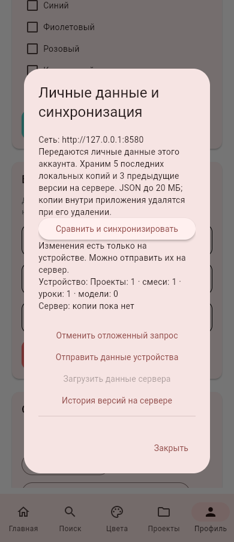
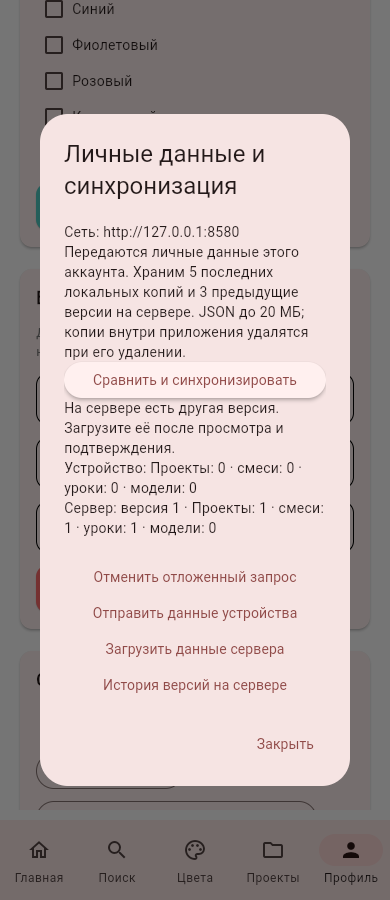
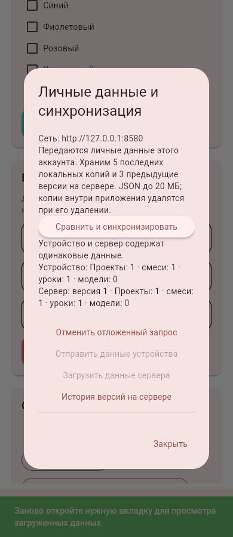
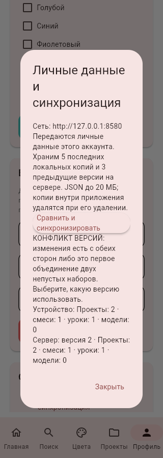

# Блок №24 — личные данные, версии и восстановление

02.11.2026. Продолжение №23. Оставшаяся очередь: [remaining_work.md](remaining_work.md).

В профиле появился раздел **«Личные данные и синхронизация»**. Переносятся проекты (этапы, фото, порядок, рецепты, дедлайн, заметки, даты создания и завершения), личные смеси, учебный прогресс, заметки и избранное уроков, импортированные OBJ/MTL и избранное моделей. Пароли, токены, API-адрес, роли, профиль/аватар, публикации и чужие идентификаторы в снимок не входят. Проекты не становятся публичными после отправки личного снимка.

## Сценарий двух устройств

1. Обновить серверный пакет, сохранив прежний каталог данных. Компьютер и устройства подключены к одному роутеру.
2. Войти в один серверный аккаунт на обоих устройствах. Данные старого локального аккаунта переносятся отдельно: полный JSON из него можно импортировать в технического владельца серверного аккаунта; совпадение email само по себе данные не объединяет.
3. На первом устройстве открыть профиль → личные данные → сравнить → отправить и подтвердить.
4. На втором сравнить → загрузить и подтвердить. Перед заменой автоматически сохраняется полная копия прежних данных второго устройства.
5. Если изменения есть с обеих сторон или это первое объединение двух непустых наборов, отображается конфликт. Пользователь выбирает источник. Повторная смена серверной версии остановит отправку с HTTP 409; локальные изменения после просмотра также остановят замену.

Это ручная синхронизация целого снимка: нельзя автоматически объединить две разные правки одной фигурки. На первом этапе приоритет — контроль версии и возможность вернуться к прежним данным. После загрузки заново открыть нужную вкладку. Состояния прочтения уведомлений, напоминания и настройки уведомлений устройства не синхронизируются.

## История и копии

До пяти последних полных копий хранятся в SQLite устройства в сжатом виде, с SHA-256. Перед каждым восстановлением/загрузкой создаётся страховочная копия. Копии разделены по владельцам, восстановление выполняется одной транзакцией; при ошибке остаются исходные данные. Фото проверяются, а сохранённые байты после восстановления не пережимаются повторно. Модели проверяются существующим ограниченным OBJ-декодером, превью строятся заново.

На сервере — текущая версия и до трёх предыдущих. Историческая версия загружается локально; следующая явная отправка создаёт новую серверную версию. Совпадающий снимок не создаёт дублей даже после потери ответа. Ревизия и контрольная сумма хранятся отдельно для пользователя и адреса сервера.

Локальные копии удаляются при удалении приложения. На ПК/в браузере есть полный JSON-экспорт; на Android экспорт сохраняется во внутренние копии, а перенос на другое устройство выполняется через Wi-Fi. Полный JSON можно импортировать через выбор файла с предварительным просмотром и отдельным подтверждением замены.

Предел снимка — 20 МБ, до 100 проектов, 300 смесей и 20 импортированных моделей; сохраняются ограничения отдельных проектов/моделей. Если данные больше лимита или содержат повреждённый старый рецепт, операция останавливается без частичного переноса. Для больших наборов остаются прежние экспорты отдельных проектов/моделей.

## Отложенный запрос

Если компьютер недоступен во время сравнения/отправки, сохраняется отметка отложенного запроса. На повторном открытии она видна; при восстановлении сети нужно снова нажать сравнение. Отправляются актуальные данные, а не устаревший буфер. Это не автоматическая фоновая очередь публикаций, лайков и комментариев; она остаётся следующим блоком. Серверные токены не попадают в архив и пока не сохраняются для офлайн-перезапуска приложения.

API: `GET /personal/snapshot-meta`, `GET /personal/snapshot`, `PUT /personal/snapshot`, `GET /personal/snapshot-history`. Владельца определяет Bearer-сессия. Неизвестные поля отклоняются, размер фактического потока ограничен, изменение выполняется с ожидаемой ревизией. Удаление аккаунта очищает его снимки, историю и локальные копии в этой базе через внешние ключи. Копии чужих устройств удалённо не стираются.

Исходное ТЗ не изменено. APK 0.7.1 предшествует этому блоку; новая сборка требуется для проверки на телефоне.

## Проверки

Полный локальный прогон — 405 тестов, затем добавлена проверка очистки всех новых таблиц при удалении аккаунта и повторены профильные сценарии. Проверяются полный перенос с фото/датами/моделями, неизменность идентичности, локальные копии/лимиты/владелец/повреждение, откат при ошибке, устаревший предварительный просмотр, HTTP 409, повтор после потери ответа, историческая версия, ограничения тела, авторизация и очистка аккаунта. Составы серверного пакета и Android прошли отдельную проверку.

В браузере два независимых процесса Flet и один настоящий API прошли отправку первого устройства, загрузку на втором с подтверждением и страховочной копией, повторное сравнение и конфликт после правок с обеих сторон. На втором клиенте локальный ID 2 соответствует серверному ID 1: чужой локальный проект ID-владельца 1 остался на месте. Итоговая база и контроль внешних ключей проверены. Ошибок JavaScript нет. В процессе исправлен возврат из вложенных подтверждений в главное окно синхронизации.

