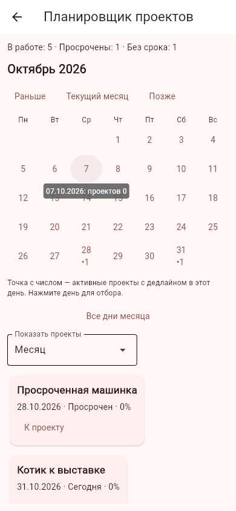
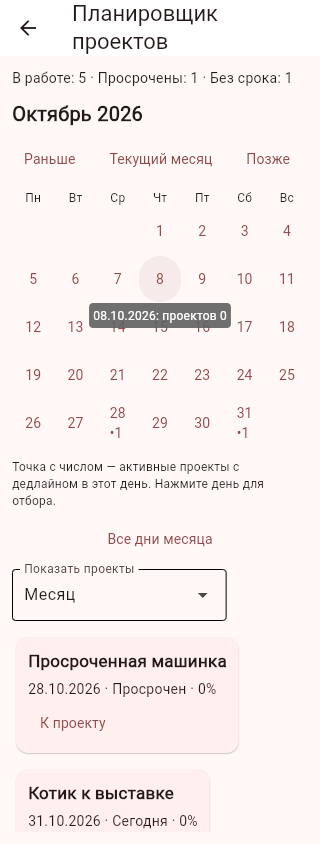
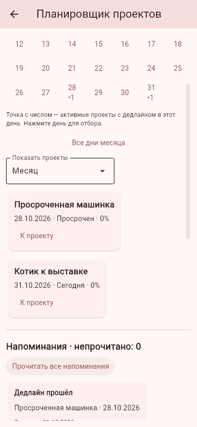
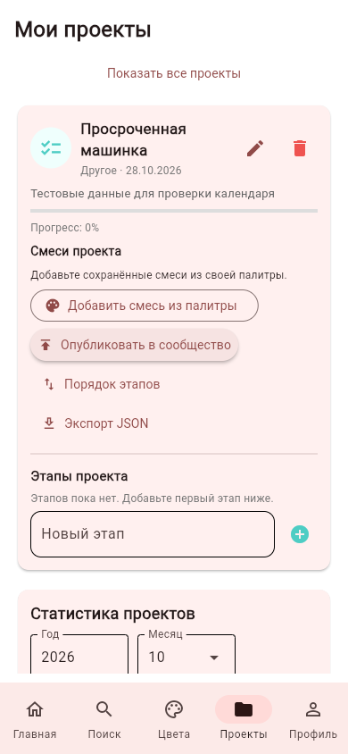

# Календарь проектов и напоминания

Ветка `feature/project-calendar-reminders`, поверх 3D-блока #14. Дата проверки: 31.10.2026 (Москва). ТЗ, его исторический срок и исходный план не изменены. Предложения пользователя о полноэкранном 3D, импорте моделей и будущем редизайне записаны в [очереди доработок](development_backlog.md).

## Пользовательский сценарий

На главной и в «Проектах» появилась карточка «Сроки проектов» с числом непрочитанных напоминаний, тремя последними непрочитанными сообщениями и кнопкой «Календарь и напоминания».

Календарь начинается с понедельника, показывает активные дедлайны точкой и числом проектов в ячейке. Нажатие дня отбирает проекты на этот день. Кнопки меняют месяц и возвращают к текущему. Фильтры показывают месяц, просроченные, ближайшие семь дней (от сегодня до сегодня + 7 включительно), проекты без срока, все активные и завершённые. Итоговые числа относятся ко всем личным проектам, а не только выбранному месяцу. Завершённые проекты не отмечаются в ячейках дедлайнов.

Из календаря и напоминания можно перейти к нужному проекту: он показан первым и доступен для обычного редактирования, переноса дедлайна, изменения этапов и завершения. «Показать все проекты» снимает отбор. Идентификатор передаётся внутри сессии с привязкой к владельцу; проект повторно ищется среди актуальных проектов пользователя.

Исторические некорректные даты не обрушивают экран: такие проекты попадают в «Без срока» с пометкой «Проверьте дату». Исходные даты автоматически не исправляются. Новые даты по-прежнему проверяет сервис проектов.

## Напоминания и настройки

При открытии главной, проектов и планировщика проверяется текущий срок. За два дня, за день, в день дедлайна и после просрочки создаётся отдельная запись. Пропущенные дни не восстанавливаются задним числом. Напоминание о просрочке для одного неизменного срока создаётся один раз. Повторное открытие экрана сохраняет идентификаторы и отметки прочтения. Можно прочитать весь список или открыть отдельное напоминание и соответствующий проект.

Хранятся максимум 100 сообщений. Если одновременно подходят более 100 проектов, сначала учитываются ближайшие будущие сроки и сегодня, затем ближайшие просроченные сроки; набор стабилен между открытиями. Этот предел не ограничивает число проектов в календаре. Изменённый срок и завершённый проект убирают старые сообщения при следующей проверке; удаление проекта или аккаунта каскадно удаляет связанные напоминания в той же транзакции.

В настройках профиля показан ранее существовавший переключатель «Уведомления». Он управляет этим блоком, сохраняет язык и тему как прежде. При отключении список скрыт и новые сообщения не создаются; прежние отметки прочтения сохраняются. В режиме API настройка берётся из серверного профиля, а проекты и напоминания остаются в клиентской SQLite под локальным владельцем, сопоставленным с серверным аккаунтом.

## Реализация и границы

`project_planner.py` содержит расчёты и операции с напоминаниями, `views/project_planner.py` — экран `/planner` и краткую карточку. Новая таблица `projectReminders` добавляется без изменения существующих данных. Уникальность `(userId, projectId, deadlineDate, kind)` предотвращает дубли, транзакция согласует очистку, добавление и ограничение списка. Запросы и обработчики ограничены владельцем; заблокированный аккаунт не читает и не изменяет сообщения. Все новые модули включены в подготовку Android и контрольной поставки.

Используется местная дата среды, где работает Python: на Android — устройства, в браузерном режиме — компьютера с Flet-сервером. Автоматического часового пояса браузера, фонового планировщика, email-доставки и push при закрытом приложении нет. Это центр напоминаний о проектах; уведомления о лайках, комментариях и конкурсах ещё не добавлены. Другие устройства не синхронизируют эти сообщения.

## Проверки

291 автоматическая проверка на временных данных: основной набор приложения и новые сценарии високосного февраля, границ дат, отбора сроков, повреждённой старой даты, смены этапа напоминания, идемпотентности, отметки прочтения, стабильного лимита 100, переноса срока, завершения, удаления и изоляции владельца. UI-проверки проверяют переход к проекту, снятие отбора и отказ старых обработчиков после завершения сессии. Отдельный сценарий запускает настоящий API в другом процессе и подтверждает, что серверная настройка отключает локальные напоминания, а совпадающие ID сервера и клиента не смешивают проекты.

Браузерная проверка Chromium с настоящим Flet-сервером на отдельной синтетической базе прошла: вход, календарь, выбор дня, следующий и текущий месяц, ширина 320 пикселей, прочтение всех сообщений, переход к выбранному проекту, снятие отбора, сохранение переключателя уведомлений в профиле и скрытие списка. JavaScript-ошибок нет. Отдельная проверка SQLite подтверждает четыре сообщения с сохранённым прочтением и отключённую настройку. Подготовка Android включает оба новых модуля, контрольный ZIP — документацию и тесты, без личных баз или секретов. Этот блок не собирает новый APK; Android-проверка календаря, навигации и настроек запланирована вместе со следующей общей сборкой.

