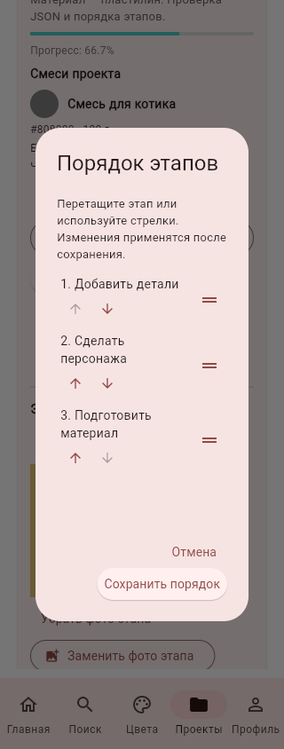
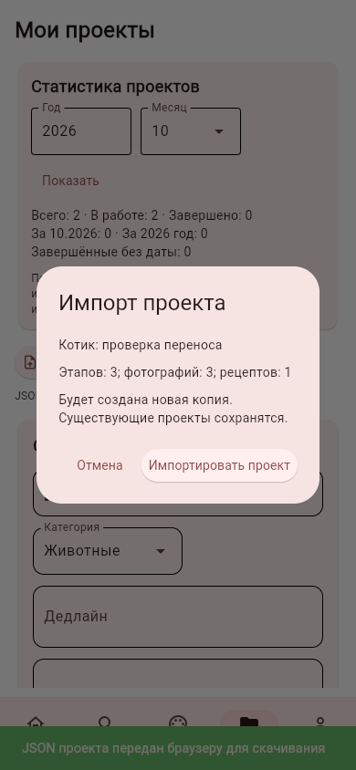
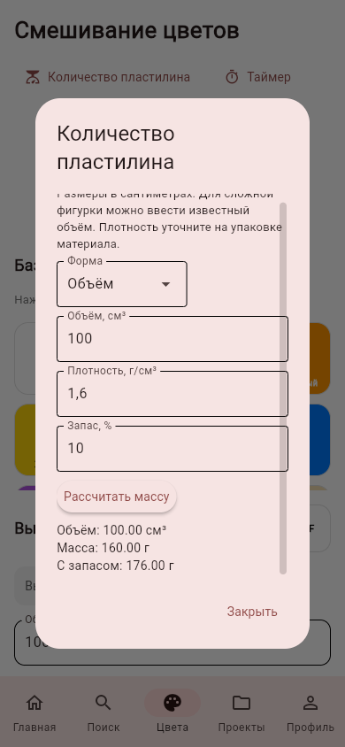

# Проекты и инструменты: единый блок после 0.6.1

Разработка и проверка ведутся через GitHub. Промежуточная APK не собиралась.
ТЗ и его срок не менялись. Редизайн остаётся отдельным завершающим этапом.

## Порядок этапов

Стрелки находятся под названием этапа, справа выделено место для штатной ручки.
Окно просмотрено в Chromium при ширине 390 и 320 пикселей. Выполнены настоящий
клик стрелки и перетаскивание ручки, порядок сохранён и проверен в JSON.

## Перенос проекта JSON

В карточке проекта — «Экспорт JSON», над списком — «Импорт JSON». Формат
`lepka-helper-project`, версия 1, UTF-8: название, категория, дедлайн, заметки,
этапы в выбранном порядке, их фото Base64 и отметки, до 10 прикреплённых рецептов.
Чужие ID, токены, пароли, пути файлов и данные аккаунта в файл не попадают.

Импорт показывает название и состав, затем создаёт новую копию для текущего
пользователя. Отмена ничего не записывает. Проверка всего файла и фото предшествует
транзакции; ошибка не оставляет частичного проекта. Старые проекты не заменяются.
Ограничения: 20 МБ JSON, 100 этапов, 10 рецептов; фото проходят ту же проверку и
нормализацию, что при обычном добавлении. Завершённый этап требует фото, в том
числе при переносе прежнего проекта. Перед экспортом старого завершённого этапа
без фото нужно добавить фото либо снять отметку завершения.

В браузере — одноразовые HTTP-загрузка и скачивание с проверкой действующей
сессии. Поток ограничен фактическими байтами, а не только Content-Length.
Путь ПК от веб-клиента не читается. Файлы загрузки живут в памяти до 10 минут;
одновременно допускается 10 загрузок, кеш скачиваний ограничен 64 МБ.

На ПК в отдельном окне используется системный выбор файла/сохранение без
перезаписи существующего файла. На Android старый Flet передаёт системному
сохранению пустые bytes. Поэтому здесь используется каталог приложения:
«Экспорт JSON» сохраняет копию, «Копии в приложении» позволяет восстановить или
удалить её с подтверждением. Копии раздельны по владельцу и имеют права 0600.
Это не выгрузка файла в общую папку Android; удаление приложения удалит и такие
копии. Переносимый внешний JSON сейчас надёжно получаем через браузер/ПК.
Настоящий Android FilePicker для этого блока отдельно не проверялся.

## Статистика

«Проекты» показывают всего, в работе, завершено, завершено за выбранный месяц и
год, завершено без известной даты. Периоды — UTC, что указано на экране.
Дата завершения записывается при переходе к 100%; повторное чтение её не меняет.
Возврат этапа в работу снимает текущую дату; новое завершение получает новую.
Это число завершённых проектов, а не журнал многократных завершений одного проекта.
При миграции и импорте историческая дата не выдумывается: такие завершённые
проекты попадают в отдельный счётчик. При импорте копии дата оригинала неизвестна.

## Калькулятор и таймер

Во вкладке «Цвета»: «Количество пластилина» и «Таймер».
Объём можно ввести в см³ или рассчитать для бруска, шара (диаметр) и цилиндра
(диаметр и высота), размеры в сантиметрах. Масса = объём × плотность; запас
добавляется процентом. Плотность 1,6 г/см³ — пример, её нужно уточнять для материала.
Пустые, отрицательные, бесконечные и NaN-значения отклоняются. Результат после
расчёта автоматически прокручивается в видимую часть окна.

Таймер: длительность до 1440 минут, старт/продолжение, пауза, сброс, отображение
окончания. Используются монотонные часы, поэтому задержка обновления экрана не
накапливает ошибку отсчёта. Закрытие окна таймера сохраняет отсчёт в текущей
сессии; полное завершение приложения сбрасывает его. Системного фонового
уведомления и восстановления после завершения процесса здесь нет.

## Проверки

Локальный полный набор: 254 теста, OK; `pip check` и `git diff --check` пройдены.

Автотесты проверяют перенос фото/рецептов/порядка/отметок, отдельного владельца,
отказ повреждённых файлов, откат после ошибки уже внутри транзакции, пределы
размера, отзыв сессии, одноразовую передачу, частную область копий, статистику,
формулы, таймер без реального ожидания и обработчики Flet.

В Chromium: 390 и 320 px; стрелка и реальное перетаскивание; скачивание JSON,
настоящий FileChooser и HTTP-загрузка, подтверждение импорта. SQLite отдельно
подтвердила порядок, 3 фото, 2 отметки, рецепт и заметки в новой копии. Введён
объём 100 см³, получены 160 г и 176 г с запасом; короткий таймер дошёл до нуля.
Данные и изображения синтетические, пользовательская база не использовалась.
Публичные ресурсы Flutter получались через APIRequestContext с действующей TLS-
проверкой: Chromium облачной среды сам не доверяет сертификату её прокси.

В GitHub добавлен workflow Python checks: установка Python 3.12, проверка
зависимостей, полный unittest и git diff --check. Секреты и действующий API не нужны.
Браузерный сценарий в workflow не входит, он выполнен отдельно в этой среде.

Дальше крупные блоки: 3D/медиаматериалы; избранное и поиск; сервер с доступным
HTTPS-адресом; системные мобильные возможности и итоговая Android-проверка.
Редизайн выполняется после согласованного функционального состава.
