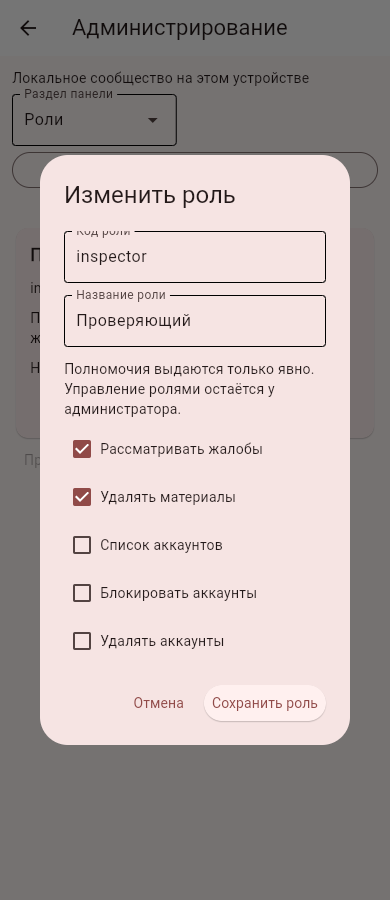
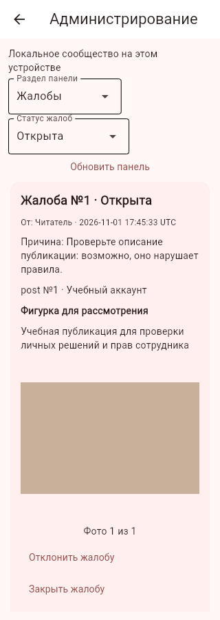
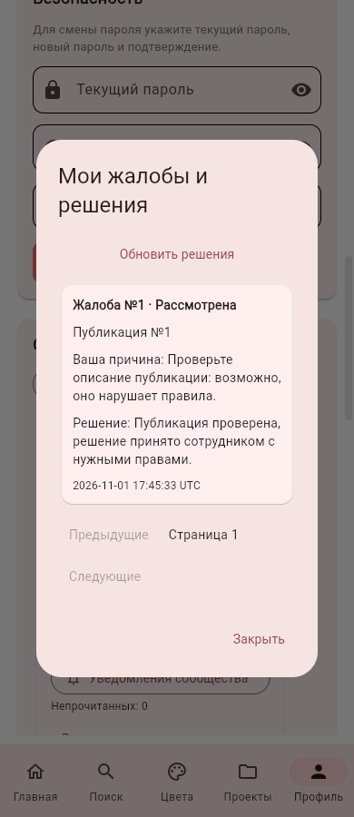
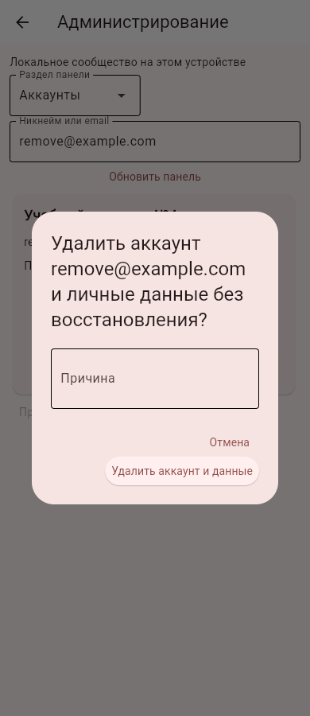
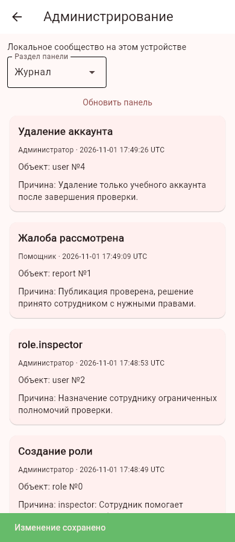

# Роли сотрудников, удаление аккаунтов и готовый пакет сервера

01.11.2026, Москва. Ветка `feature/roles-admin-server`, продолжение №20.

## Администрирование

Администратор открывает «Роли» в панели, задаёт код, название, явные права и причину. Можно создать до 20 ролей. Код — 3–24 латинские буквы/цифры/подчёркивания с буквы, название — 3–50 символов. Встроенные `user`, `admin`, `guest`, `deleted` не редактируются и не удаляются.

Доступные права сотрудника:

| Право | Действие |
|---|---|
| `reports.manage` | Просмотр и рассмотрение жалоб |
| `materials.remove` | Удаление чужих публикаций/комментариев |
| `accounts.view` | Список аккаунтов и поиск |
| `accounts.block` | Блокировка/разблокировка обычных пользователей |
| `accounts.delete` | Удаление обычных пользователей |
| `contests.manage` | Создание конкурсов, отмена и ручные итоги |
| `audit.view` | Журнал действий |

Для блокировки/удаления в роли также явно выбирается просмотр аккаунтов. Создание/редактирование ролей и назначение ролей доступны только полному администратору: привилегия `roles.manage` не выдаётся пользовательским ролям. Сотрудники не меняют роли, не блокируют/удаляют администратора, других сотрудников или себя. Полный администратор может управлять сотрудниками и другими администраторами с прежней защитой своего аккаунта и последнего действующего администратора в панели.

Права проверяются заново по базе при каждом действии, роль из тела запроса не принимается. Кнопки и разделы показываются по снимку прав; изменение ролей/прав отзывает действующие сессии затронутых пользователей. Старый обработчик интерфейса не получает полномочий из старого снимка. Базовый подтверждённый пользовательский функционал по-прежнему защищён сессией и принадлежностью данных; редактор в этом пакете управляет перечисленными административными полномочиями, не всеми личными действиями приложения.

В «Аккаунтах» можно назначить пользовательскую роль. Для удаления аккаунта открывается подтверждение с его email, предупреждением о необратимости и обязательной причиной. Удаление вызывает штатную очистку данных: личные проекты/смеси/сессии удаляются, публикации становятся прежними обезличенными заглушками без фото, чужие комментарии сохраняются согласно существующему механизму. Открытые жалобы на публикации/комментарии удаляемого автора закрываются с тем же объяснением. Удаление, решения по жалобам и журнал атомарны; удаления реальных аккаунтов в ходе разработки не выполнялись. В API-режиме очищается серверная база и отзывается вход; удалённая очистка личных баз выключенных устройств этим действием не выполняется. Почтовое извещение о блокировке/удалении ещё не подключено.

В профиле появилась кнопка **«Мои жалобы и решения»**: только собственные жалобы, статус и опубликованное объяснение, обновление и страницы по 50. История доступна и после удаления материала. ID и персональные данные других заявителей/модераторов не выдаются.

API: `GET /community/access`, `GET /community/my-reports`, `GET /admin/roles`, `POST|PUT /admin/roles/{code}`, `POST /admin/roles/{code}/delete`, `POST /admin/users/{id}/delete`. Причина требуется во всех изменениях, роли и назначение журналируются. Миграция добавляет `customRoles`, существующие роли/аккаунты сохраняются. Локальный режим и API используют одну модель разрешений; серверные ID не смешиваются с локальными техническими владельцами.

## Упаковка и запуск сервера

Исправлен Dockerfile: старый список не включал модули модерации, конкурсов и новых уведомлений. Теперь в образ входят все серверные зависимости и служебные команды, включая правильные права каталога `/app/scripts`. Flet/интерфейс приложения в образ не устанавливается.

Подготовка отдельной папки без пользовательских баз, GUI, настроек клиента и секретов:

```sh
python scripts/prepare_server.py --output /new/path/lepka-server
```

Состав фиксирован явным списком, `SERVER_MANIFEST.json` содержит SHA-256 файлов и исходный коммит. Существующая папка не перезаписывается. Проверка зависимостей и изолированный запуск включены в тесты.

Из корня исходного или подготовленного пакета:

```sh
docker compose -f backend/compose.yml up -d --build api
```

API доступен только через `127.0.0.1:8000`, данные сохраняются в именованном томе. `GET /health` — жизнеспособность процесса, `GET /ready` — доступность существующей базы; проверка не создаёт потерянную базу и не выдаёт внутренние пути. Docker HEALTHCHECK использует `/ready`. Один процесс Uvicorn сохраняет текущие ограничения SQLite/лимитов.

Для будущего публичного HTTPS подготовлены `backend/Caddyfile`, профиль Compose `public` и пустой образец `backend/.env.example`. Перед запуском нужны выбранный сервер/домен и DNS; `LEPKA_DOMAIN` задаёт имя. Внешний Caddy использует 80/443, API остаётся внутри стека. Ключ почты передаётся средой/секретами, не в образе и не клиенте. В прокси-среде сборка использует прежний секрет `ca_bundle`, TLS не отключается.

Публичный сервер в этом пакете **не размещался**, домен/платный хостинг не создавались. Подготовлен и локально проверен контейнер, а не работающий публичный адрес для Android.

## Резервная копия и восстановление

Команды требуют явных исходного и нового выходного файла:

```sh
python -m scripts.server_backup backup --source /path/accounts.db --output /new/path/accounts-backup.db
python -m scripts.server_backup restore --source /path/accounts-backup.db --output /new/restore-data/accounts.db
```

Используется SQLite Backup API и проверка целостности, исходник открывается только для чтения. Существующий выходной файл/исходник никогда не перезаписываются, новый файл создаётся с правами 0600. Неудачная операция удаляет только созданный ею незавершённый файл. Восстановление сохраняет данные, очищает старые сессии и одноразовые коды, добавляет запись журнала. Само переключение работающего сервера на восстановленную копию не выполняется: сначала остановка сервера и проверка новой копии. Резервная база содержит личные данные и должна храниться вне Git/публичной раздачи.

## Проверки и дальнейшая очередь

Проверяются полномочия и запрет повышения роли, отзыв сессий, ограничения целей сотрудника, откат при сбое журнала, очистка данных, личная история, UI редактора/удаления и настоящий API с разными ID двух баз. Серверный пакет проверяется на полноту локальных импортов и запускается отдельным процессом без Flet. Копирование/восстановление проверяются на синтетических данных с сохранением исходника и отзывом старых кодов/токенов.

Docker-образ собирался и запускался локально с отдельным томом: подтверждены `/ready`, отсутствие Flet, действующие маршруты сообщества/конкурсов/уведомлений, разрешённое чтение жалоб и запрет списка аккаунтов для ограниченной роли. Копирование/восстановление в контейнере также проверены. Публичный TLS и физический Android ещё не проверены. Новый APK не собирался, редизайн остаётся в конце функциональных доработок. Исходное ТЗ не менялось.

Проверки: полный набор из **375 тестов прошёл**. После уточнения закрытия связанных жалоб повторно пройдены проверки ролей/удаления и UI редактора; для серверной поставки и удалённого клиента выполнены отдельные проверки. Финальный контейнер пересобран и перезапущен с прежним тестовым томом: аккаунты и роли сохранились, готовность/ограниченные права и удаление учебного автора с закрытием жалобы подтверждены через HTTP.

В браузере три синтетических аккаунта прошли создание и назначение роли, панель сотрудника на 320 px, решение по жалобе, личную историю и удаление учебного аккаунта. Состояние сверено в отдельной БД, ошибок страницы нет. Подписи прав укорочены для узкого редактора.






